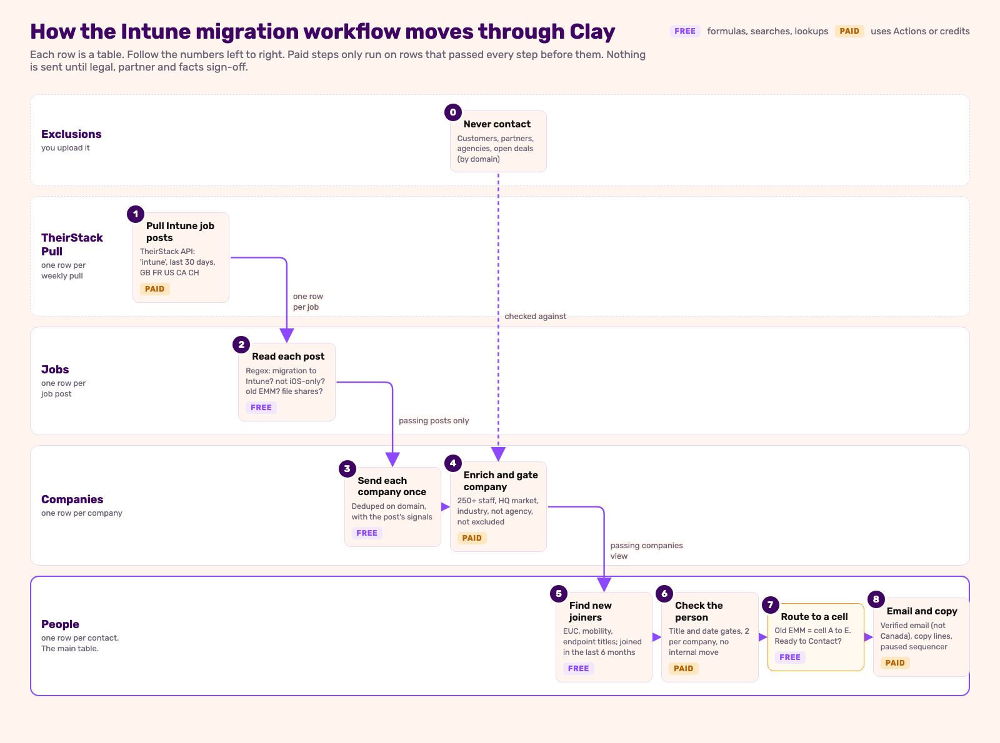

# Clay Build Guide: Intune migration leaves file shares behind (Hypergate)

A step-by-step guide to building [`workflow-spec.md`](../workflow-spec.md) in Clay. It's written for someone who has never built anything in Clay. Follow the parts in order. Each step tells you **why** it exists, **what to click**, **what to type**, **how to check it worked** and **what it costs**.

> **Don't skip the checks.** The most common Clay mistake is running a column on hundreds of rows before checking it worked on one. Every step below ends with a check. If a check fails, fix it before moving on.

> **Nothing sends from this build yet.** The spec's status line says there are no sends until three things happen: legal signs off the compliance brief, Hypergate sales answers the partner-region memo, and Hypergate approves the claims in `facts.md` (F1 to F9). You build everything, including the sequencer step, and run nothing that sends.

---

## Contents

- [What you are building](#what-you-are-building)
- [Clay words you need](#clay-words-you-need)
- [Before you start](#before-you-start)
- [Part 0. Set up the workbook](#part-0-set-up-the-workbook)
- [Part 1. Exclusions table](#part-1-exclusions-table)
- [Part 2. Pull the Intune job posts (TheirStack)](#part-2-pull-the-intune-job-posts-theirstack)
- [Part 3. Read each job post (free gates)](#part-3-read-each-job-post-free-gates)
- [Part 4. Companies table](#part-4-companies-table)
- [Part 5. Find the new joiners](#part-5-find-the-new-joiners)
- [Part 6. Free checks on each person](#part-6-free-checks-on-each-person)
- [Part 7. Pick at most 2 people per company](#part-7-pick-at-most-2-people-per-company)
- [Part 8. Check the person (Enrich Person)](#part-8-check-the-person-enrich-person)
- [Part 9. Route each person to a cell](#part-9-route-each-person-to-a-cell)
- [Part 10. Find and verify the work email](#part-10-find-and-verify-the-work-email)
- [Part 11. Write the copy lines](#part-11-write-the-copy-lines)
- [Part 12. Views for the operator](#part-12-views-for-the-operator)
- [Part 13. Connect the sequencer and the LinkedIn queue (build it, don't run it)](#part-13-connect-the-sequencer-and-the-linkedin-queue)
- [What it costs](#what-it-costs)
- [Final checklist](#final-checklist)
- [When something goes wrong](#when-something-goes-wrong)
- [Things the spec needs to fix](#things-the-spec-needs-to-fix)

---

## What you are building

The spec (section 1) says: find organisations that posted a job in the last 30 days that names a **move of the mobile fleet to Microsoft Intune**. When a company moves to Intune, the file tool tied to its old EMM (Docs@Work, Workspace ONE Content, BlackBerry Work or SOTI Hub) stays behind. "Intune lacks a built-in solution for accessing SMB/CIFS network file shares", which is the gap Hypergate Files fills.

The workflow then:

1. Keeps companies with 250+ staff, HQ in the UK, France, the US, Canada or Switzerland, and an allowed industry, that aren't on the never-contact list.
2. Finds up to 2 people per company who own the device fleet (EUC, mobility, endpoint) and **joined in the last 180 days**.
3. Routes each person to one of 5 cells (A to E) by the old EMM named in the post.
4. Writes the approved copy lines.
5. Gets each person ready for a paused email sequence plus a manual LinkedIn queue. Canadian contacts are LinkedIn-only.

You will build **5 tables** inside **1 workbook**:



Each row of the picture is a table. The numbers are the order you build in. Step 0 is the list you upload first.

Why this shape:
- **Signal first.** The trigger is a dated event at a company: a job post. So the build starts from job posts, not from a list of people or companies.
- **Company checks happen once per company.** If a company has three Intune posts, you pay to enrich it once, not three times.
- **People come after the company gates.** A company that fails (too small, wrong country, excluded) never costs a people search, an Enrich Person or an email lookup.
- **Everything paid runs last**, and only on rows that passed every free check before it.

What a finished row in **People** looks like, reading left to right (made-up values, not a real lead):

| Name | Title | Company | Started | Country | Post title | R1 | Cell | Ready? | Email | E1 L1 | E1 L2 | E2 L1 |
|---|---|---|---|---|---|---|---|---|---|---|---|---|
| Sam T. | Senior Endpoint Engineer | Acme Bank | 2026-08 | GB | Endpoint Engineer | ivanti | A | Yes | sam.t@acmebank… | From the Endpoint Engineer role Acme Bank has open… | If phones reach file shares through Docs@Work today… | If staff open files from the network shares… |

---

## Clay words you need

| Word | What it means |
|---|---|
| **Workbook** | A folder of tables for one campaign. |
| **Table** | A spreadsheet. One row per job post, company or person. |
| **Source** | Where a table's rows come from (a Clay search, a CSV, another table, a webhook). |
| **Column** | One piece of information per row. Three kinds matter: **plain** (you type or import it), **formula** (Clay calculates it, free), **enrichment / action** (Clay calls a data provider or an API, usually costs). |
| **Formula** | A small calculation, like a spreadsheet formula. Free. Clay has an AI helper: describe what you want in plain English and it writes the formula for you. |
| **Regex** | A text pattern. `\bintune\b` means "the word intune". This build reads job posts with regexes inside formulas, so it's free and gives the same answer every time. |
| **HTTP API** | A column that calls an outside service (here, TheirStack) and returns its answer. Costs Actions. |
| **Enrichment** | A column that looks something up (company size, a person's past jobs, an email). Costs **Actions**, and sometimes **Data Credits**. |
| **Lookup** | A column that reads matching rows from another table in your workbook. Free. |
| **Send table data** | A column that copies rows from this table into another table. Free. Sometimes called "Write to table". |
| **Run condition** ("Only run if") | A rule on a paid column: it only runs on rows where the rule is true. This is how you avoid paying for rows you'll throw away. |
| **Auto-run** | When on, new columns run on every row by themselves. **Keep it off** while building. |
| **Deduplicate** | A table setting that keeps one row per value of a key column (job ID, domain or LinkedIn profile). |
| **Actions** | Clay's main usage meter. About 1 Action per enrichment per row. Unused Actions expire monthly. |
| **Data Credits** | A second meter, used when Clay pays a data provider for you (for example, email finders). |
| **View** | A saved filter on a table, like "only rows ready to send". |
| **Cell (routing)** | One of the spec's 5 message routes, A to E. Not the same as a spreadsheet cell; this guide says "routing cell" where it could be confused. |

---

## Before you start

Tick these off **before** you build. None of them should be done live.

- [ ] **Clay account** with access to the workspace you'll build in. Note the plan (Settings → Plans & billing). You need enough Actions for roughly: 1 per pull + number of companies + number of picked people + email lookups. See [What it costs](#what-it-costs).
- [ ] **TheirStack account and API key.** The spec (section 3) uses TheirStack's Jobs API. Its free tier is 200 credits a month (spec section 3, from [signal-matrix.md](../../../../context/icp/signal-matrix.md) 2a). Store the key only inside Clay (the HTTP column's header or Clay's secrets, if your plan has them). Never paste it into this repo, a doc or a chat. If it must live in a file, use the repo's `.env`, which Git ignores.
- [ ] **Confirm TheirStack's request fields** in its API docs before Part 2: the description keyword filter, the posted-within-days filter, the country filter, the page size, and whether there is a filter for recruiting agencies. The spec says to confirm these (section 3), and this guide gives the likely names.
- [ ] **Email finder connections** (Settings → Connections), if you'll use your own provider keys. Without them, Clay uses its own and charges Data Credits.
- [ ] **The spec is open** next to you: `output/campaigns/intune-migration-file-shares/workflow-spec.md`. You'll build from:
  - section 2 (who's in and out, contact titles);
  - section 3 (sources);
  - section 4 (signals and regexes);
  - section 5 (cells);
  - section 6 (variables);
  - the Copy section.
- [ ] **The Exclusions CSV** is ready (Part 1 shows exactly what goes in it).
- [ ] **Test size: 25.** The first TheirStack pull is limited to **25 job posts**. You can pull more once every check passes.
- [ ] **Know what you may not do yet:** don't push any lead to a sequencer, don't send LinkedIn requests, and don't run the email waterfall beyond 1 test row (see Part 10 for why).

---

## Part 0. Set up the workbook

**Why:** one place for everything in this campaign, so anyone can find it and follow it.

1. In Clay, click **+ New** (top left) → **Workbook**.
2. Name it: `Hypergate · Intune migration file shares (v1)`.
3. In the workbook description, paste: *"Signal: job posts in the last 30 days naming a move to Intune (GB, FR, US, CA, CH). Lead product: Hypergate Files. Spec: hypergate-gtm-os/output/campaigns/intune-migration-file-shares/workflow-spec.md. No sends until legal, partner-region and facts.md sign-off. Canada is LinkedIn-only."*

**Check:** the workbook appears in your Clay home with that name.
**Cost:** free.

---

## Part 1. Exclusions table

**Why:** the spec (section 2, Exclude) lists organisations we must never contact: Hypergate's customers and its 28 listed partners, plus staffing agencies and open deals found later. They go in one table so the Companies table can check every company against it.

### 1.1 Make the CSV

Create a spreadsheet with **3 columns** and save it as `exclusions.csv`. Rows below are everything the spec says to load now (37 rows).

**Customers** (the 9 logo-wall customers, [case-studies.md](../../../../context/docs/case-studies.md)). The research has **no domains** for these, so the Domain column is blank on purpose:

| Company Name | Domain | Type |
|---|---|---|
| Jefferies | | customer |
| Noble Corporation (Maersk Drilling) | | customer |
| York Regional Police | | customer |
| Bayerische Staatskanzlei | | customer |
| Linz AG | | customer |
| European Court of Auditors | | customer |
| Suva | | customer |
| States of Jersey Police | | customer |
| USPS | | customer |

**Partners** (the 28 listed partners; domains taken from the partner links in [company.md §7](../../../../context/docs/research/company.md)):

| Company Name | Domain | Type |
|---|---|---|
| Nomasis | nomasis.ch | partner |
| Mobco | mob.co | partner |
| XSAT India | xsatindia.in | partner |
| Enox | enox.com.tr | partner |
| QBS Software | qbssoftware.com | partner |
| Anyplace IT | anyplace-it.de | partner |
| Blaud | blaud.com | partner |
| Headtechnology | headtechnology.com | partner |
| 3Eye Technologies | 3eyetech.com | partner |
| Leaders Fort Tech | leadersfort-tech.com | partner |
| Conscia | conscia.com | partner |
| Appurity | appurity.co.uk | partner |
| EBF | ebf.com | partner |
| CANCOM (Austria) | cancom.at | partner |
| SDS | sds4e.com | partner |
| Qolcom | qolcom.co.uk | partner |
| iSEC7 | isec7-gs.com | partner |
| IT Point | itpoint.ch | partner |
| Milan Consult | milanconsult.de | partner |
| HiTech Defense | hitechdefense.com | partner |
| Troy Mobility | troymobility.com | partner |
| Kontron Hungary | kontron.hu | partner |
| SoftwareONE | softwareone.com | partner |
| Techstep | techstep.io | partner |
| System4u | system4u.com | partner |
| Symphony Solutions | symphony-solutions.com | partner |
| Proget | proget.pl | partner |
| IMTAC | imtac.com | partner |

**Domain** is how every check matches against this list. Type it plain, the way Clay shows domains: `ebf.com`. No `https://`, no `www.`, no slash at the end.

> **Why domain and not name:** names clash and vary. "Conscia" or "Techstep" could match unrelated companies, and the same company appears as "SoftwareONE", "SoftwareONE AG" or "SoftwareOne Schweiz". A domain belongs to one company.

> **Fill the 9 customer domains before the first send.** Take each one from the customer's own website (check it's the organisation's main site, not a product or country subdomain). Don't guess. A blank domain matches nothing, so until it's filled that customer is **not** protected. That's one more reason nothing sends yet.

> **Load later** (spec section 2): Hypergate's real customer list (`{{customer_blocklist}}`) and open deals (`{{active_pipeline}}`) from Zoho CRM, once the connector is authorised. Add them to this same CSV (Type `customer` or `open_deal`) and re-upload. Any staffing agency or MSP you spot while testing goes in with Type `agency`.

### 1.2 Upload it

1. Inside the workbook, click **+ Add table** → **Import CSV**.
2. Upload `exclusions.csv`. Name the table `Exclusions`.
3. Change the `Domain` column's type to **URL** (column header → Edit column → Data type).

**Check:** 37 rows, 3 columns. 28 rows have a domain, 9 don't.
**Cost:** free.

---

## Part 2. Pull the Intune job posts (TheirStack)

**Why:** this is the trigger (spec sections 1 and 3). TheirStack returns job posts with their **full description**, which every gate in Part 3 needs. The spec's design is a **broad pull** (the word "intune" anywhere) and then the precise migration test inside Clay as a free formula. That way you can see and check what was dropped.

You'll build 2 tables here: `TheirStack Pull` (one row per weekly pull, which makes the API call) and `Jobs` (one row per job post).

### 2.1 Create the `Jobs` table first (empty)

1. **+ Add table** → **Blank table**. Name it `Jobs`.
2. Turn **Auto-run off** (table settings, the ⚙ or "…" menu at the top → **Auto-update / Auto-run** → off).
3. Leave it empty. Part 2.4 fills it.

### 2.2 Create the `TheirStack Pull` table

1. **+ Add table** → **Blank table**. Name it `TheirStack Pull`. Auto-run **off**.
2. Add a plain text column `Pull Date` and type today's date in row 1 (format `2026-11-17`). One row = one pull. Each Monday you add a new row (spec section 7).

### 2.3 The HTTP API column

1. In `TheirStack Pull`: **+ Add column** → search **HTTP API**.
2. Method: **POST**. URL (likely; confirm in TheirStack's docs): `https://api.theirstack.com/v1/jobs/search`
3. Headers: `Authorization` = `Bearer <your TheirStack key>` and `Content-Type` = `application/json`. Paste the key here only.
4. Body (JSON). Field names are TheirStack's likely names; confirm each one in their docs and rename if they differ:
```json
{
  "page": 0,
  "limit": 25,
  "posted_at_max_age_days": 30,
  "job_country_code_or": ["GB", "FR", "US", "CA", "CH"],
  "job_description_pattern_or": ["intune"]
}
```
   - `limit: 25` is the **test size**. Raise it only after every check in Parts 3 and 4 passes.
   - If TheirStack offers a filter that removes recruiting agencies, add it (spec section 3 asks you to check). If not, Part 4's agency gate catches them.
5. Name the column `TheirStack Response`.
6. Run it on **row 1** (the only row).

**Check:** open the cell. You should see a list of jobs (often under `data`). Open one job and find:
- the job ID;
- the job title;
- the URL;
- the posted date;
- the **full description** (long text, not a 2-line snippet);
- the company name;
- the company domain (sometimes nested, for example under a company object);
- the job country.

Write down the exact field names; Part 2.4 needs them.

**Cost:** about **1 Action** for the call, plus TheirStack's own credits for the jobs returned (check TheirStack's pricing page for how it counts; at `limit: 25` it is at most 25 jobs).

> **If the description is a snippet,** stop. Every gate (T1, G3, R1, C1) needs the full text. Check TheirStack's docs for a field or option that returns the full description before going on.

### 2.4 Write one row per job into `Jobs`

1. In `TheirStack Pull`: **+ Add column** → **Send table data** (may be called "Write to table").
2. Destination: `Jobs`.
3. Choose the option that sends **each item of a list as its own row** (may be called "Send list items as rows" or "For each item in a list"). Pick the jobs list inside `{{TheirStack Response}}` as the list.
4. Map these fields (use the names you wrote down in 2.3):

| Column in `Jobs` | From each job |
|---|---|
| `Job ID` | job ID |
| `Post Title` | job title |
| `Job URL` | URL |
| `Job Posted` | posted date |
| `Job Description` | full description |
| `Company Name (post)` | company name |
| `Company Domain Raw` | company domain |
| `Job Country` | job country code |

5. Run on row 1.

> **If Send table data can't split a list into rows** on your plan, use the fallback in the spec (section 3): make `Jobs` a **webhook** table (+ Add table → Webhook), and have a small script outside Clay call TheirStack and post each job to that webhook. Ask whoever owns the repo's `tools/` folder to set it up. Don't put the API key in the script file; read it from `.env`.

### 2.5 Clean up `Jobs`

1. Table settings → **Deduplicate** → choose `Job ID`. Weekly pulls overlap (30-day lookback, pulled every 7 days), so the same post would otherwise come back up to 4 times.
2. Change `Job URL` and `Company Domain Raw` to type **URL**.

**Check:** `Jobs` has 25 rows (or fewer if TheirStack had fewer). Open 3 rows. Each has a long description that contains "intune", a company name and (usually) a domain.
**Cost:** free.

---

## Part 3. Read each job post (free gates)

**Why:** the spec (section 4) reads every signal from the job description with regexes. All of it is free. Rows that fail never reach a paid step.

**How to add a formula column:** click **+ Add column** (right end of the table) → **Formula**. You can type the formula, or click **Use AI** inside the formula box and paste the plain-English description. When a formula refers to another column, type `/` and pick the column from the list. Below, columns are written `{{Column Name}}`. Keep the plain English as the column description so anyone reading the table knows what it does.

All in `Jobs`:

| Column | Plain English | Formula |
|---|---|---|
| `Company Domain` | The company domain in lowercase, without https://, www. or anything after the first slash | `({{Company Domain Raw}} \|\| "").toLowerCase().replace(/^https?:\/\//, "").replace(/^www\./, "").split("/")[0].trim()` |
| `T1 Intune Migration?` | True if the description names a move, migration, transition, switch, consolidation or rollout within 80 characters before the word intune, or names intune followed within 40 characters by migration, rollout, transition or onboarding | `/(migrat\w*\|transition\w*\|mov(e\|ing)\|switch\w*\|consolidat\w*\|roll(ing)?\s?out)[^.]{0,80}\bintune\b/i.test({{Job Description}} \|\| "") \|\| /\bintune\b[^.]{0,40}(migration\|rollout\|transition\|onboarding)/i.test({{Job Description}} \|\| "")` |
| `G3 Not iOS-only?` | False only if the description mentions iOS, iPhone or iPad and never mentions Android; true otherwise | `!(/\b(ios\|iphone\|ipad)\b/i.test({{Job Description}} \|\| "") && !/\bandroid\b/i.test({{Job Description}} \|\| ""))` |
| `File Share Mentioned?` (C1) | True if the description mentions SMB, CIFS, file share(s), network drive(s) or share(s), NetApp or file server | `/\b(smb\|cifs\|file\s?shares?\|network\s?(drive\|share)s?\|netapp\|file\s?server)\b/i.test({{Job Description}} \|\| "")` |

> In the table above, `\|` stands for a plain `|` (it's escaped only so the table displays). When you type the formula into Clay, use plain `|`. The long formulas below are written without escapes.

### 3.1 `Migration Sentences` (helper for R1)

**Why:** spec R1 only counts an old EMM named **in a sentence that also has a migration word**. Otherwise "experience with Workspace ONE and Intune" would wrongly route to cell B.

- **Plain English:** *"Split the job description into sentences on full stops, semicolons and line breaks. Keep only sentences that contain migrat, transition, move or moving, switch, replac, from, sunset or decommission. Join them with ' | '."*
- **Formula:**
```javascript
({{Job Description}} || "").split(/[.;\n]+/).filter(s => /(migrat\w*|transition\w*|mov(e|ing)|switch\w*|replac\w*|from|sunset\w*|decommission\w*)/i.test(s)).join(" | ")
```
- **Check:** on a post that says "We are migrating from MobileIron to Intune.", this column contains that sentence.

### 3.2 `R1 Matches` and `R1` (the router)

#### `R1 Matches`: which old EMMs are named in migration sentences

- **Plain English:** *"In Migration Sentences, test four patterns: Ivanti (mobileiron, ivanti epmm, ivanti uem, ivanti neurons for mdm, epmm), Workspace ONE (workspace one, workspaceone, airwatch, omnissa), BlackBerry (blackberry uem, work, dynamics or enterprise, bes12) and SOTI (soti, mobicontrol). Return the names that match, comma-separated: ivanti, workspace_one, blackberry, soti."*
- **Formula:**
```javascript
[
  /\bmobileiron\b|\bivanti\s*(epmm|uem|neurons for mdm)\b|\bepmm\b/i.test({{Migration Sentences}} || "") ? "ivanti" : "",
  /\bworkspace\s?one\b|\bairwatch\b|\bomnissa\b/i.test({{Migration Sentences}} || "") ? "workspace_one" : "",
  /\bblackberry\s*(uem|work|dynamics|enterprise)\b|\bbes\s?12\b/i.test({{Migration Sentences}} || "") ? "blackberry" : "",
  /\bsoti\b|\bmobicontrol\b/i.test({{Migration Sentences}} || "") ? "soti" : ""
].filter(x => x).join(",")
```

#### `R1`: the routing value (spec section 4, R1 clusters)

- **Plain English:** *"If R1 Matches holds exactly one name (not empty, no comma), return it. Otherwise (none or two or more) return not_named."*
- **Formula:**
```javascript
({{R1 Matches}} || "") !== "" && !({{R1 Matches}} || "").includes(",") ? {{R1 Matches}} : "not_named"
```
- **Check:** "migrating from MobileIron to Intune" → `ivanti`. "Experience with Workspace ONE and Intune" (no migration word in that sentence) → `not_named`. "Moving from AirWatch and SOTI to Intune" → `not_named` (two matches, so the copy names no product).

### 3.3 `Job Pass?`

- **Plain English:** *"True if T1 Intune Migration and G3 Not iOS-only are both true, Company Domain is not empty and Job Description is not empty."*
- **Formula:**
```javascript
{{T1 Intune Migration?}} === true && {{G3 Not iOS-only?}} === true && !!{{Company Domain}} && !!{{Job Description}}
```

**Check:** sort by `Job Pass?`. Read 3 "false" rows and 3 "true" rows in full:
- A **false** row should really not be about a move to Intune (for example, "Intune experience a plus"), or should be iPhone-only, or should have no domain.
- A **true** row should really describe a move to Intune.

If a good post is false, fix the formula, not the row. A post with no domain is dropped: the gtm-system counts these as "unresolved" (step 2).

**Cost:** free.

---

## Part 4. Companies table

**Why:** company facts (size, HQ country, industry) are checked **once per company**, then every gate the spec puts on the company runs here (G1, G2, G4, G5, X1).

### 4.1 Create the empty table

1. **+ Add table** → **Blank table**. Name it `Companies`. Auto-run **off**.
2. Add these columns: `Company Domain` (type URL), `Company Name (post)`, `Post Title`, `Job URL`, `Job Posted`, `R1`, `File Share Mentioned?`.
3. Table settings → **Deduplicate** → `Company Domain`.

### 4.2 Send passing posts over from `Jobs`

In `Jobs`:

1. Sort the table by `Job Posted`, **newest first**. When a company has several passing posts, the first one sent is kept (dedupe), so newest-first means the copy refers to the newest post. (The spec doesn't say which post wins: see [Things the spec needs to fix](#things-the-spec-needs-to-fix) 5.)
2. **+ Add column** → **Send table data** → destination `Companies`.
3. Map each `Companies` column from step 4.1 to the `Jobs` column with the same name.
4. **Run condition:** `{{Job Pass?}} === true`
5. Run on **1 row**. Open `Companies` and check the row arrived with the right domain, post title and R1.
6. Then run on the rest.

**Check:** `Companies` has no duplicate domains and no more rows than `Jobs` has passing rows.
**Cost:** free.

### 4.3 Check the never-contact list first (free)

This runs **before** the first paid step, so excluded companies are never enriched.

1. **+ Add column** → **Lookup single row in other table** → table `Exclusions`, match column `Domain`, value `{{Company Domain}}`. Name it `Exclusion Match`. Run on all rows (free).
2. Formula `Exclusion Type`. Plain English: *"The Type value from Exclusion Match, or empty if nothing matched."* Let the AI helper write it from a real cell. It will look roughly like `{{Exclusion Match}}?.Type || ""`.

**Check:** add a test row to `Exclusions` with the domain of one company in your table. Its `Exclusion Match` fills in and `Exclusion Type` shows its type. Then delete the test row.
**Cost:** free.

### 4.4 Enrich each company

1. **+ Add column** → **Enrich Company**. Input: `{{Company Domain}}`.
2. **Run condition:** `!{{Exclusion Match}}`. Don't pay for companies already on the never-contact list.
3. Run on **1 row**. Open the cell and read what came back.
4. From that cell, **Add as column** for:
   - the company **name** → rename to `Company Name`;
   - **employee count** → `Employees`;
   - **industry** → `Industry`;
   - **headquarters country** → `HQ Country`.
5. Check that 1 row against the company's LinkedIn page. Right size? Right HQ?
6. If yes, run on the rest.

**Cost:** about **1 Action per company**. This is the first paid step after the pull.

### 4.5 Company gates (free formulas)

| Column | Plain English | Formula |
|---|---|---|
| `HQ Country Code` | Turn HQ Country into a 2-letter code: United Kingdom/UK/Great Britain → GB, France → FR, United States/USA → US, Switzerland → CH, Canada → CA. If it's already 2 letters, use it in capitals (UK becomes GB). Otherwise blank | `({"united kingdom":"GB","uk":"GB","great britain":"GB","france":"FR","united states":"US","united states of america":"US","usa":"US","switzerland":"CH","canada":"CA"})[({{HQ Country}} \|\| "").trim().toLowerCase()] \|\| (({{HQ Country}} \|\| "").trim().length === 2 ? ({{HQ Country}} \|\| "").trim().toUpperCase().replace("UK", "GB") : "")` |
| `G1 Size OK?` | Employees is 250 or more | `Number({{Employees}} \|\| 0) >= 250` |
| `G2 Market OK?` | HQ Country Code is GB, FR, US, CA or CH | `["GB","FR","US","CA","CH"].includes({{HQ Country Code}})` |
| `G4 Not Agency?` | Not on the Exclusions list as an agency, industry is not Staffing and Recruiting, and the company name doesn't contain recruit, staffing, personnel or talent | `{{Exclusion Type}} !== "agency" && !/staffing and recruiting/i.test({{Industry}} \|\| "") && !/\b(recruit\w*\|staffing\|personnel\|talent)\b/i.test({{Company Name}} \|\| {{Company Name (post)}} \|\| "")` |

> Why HQ country comes from Enrich Company and not from the job post: a US bank can post a job in its London office. The spec's market gate (G2) is about the **company HQ**. The person's own country is checked separately in Part 6.

#### `Segment` (C3): industry mapped to the ICP segments (spec section 4, "C3 / G5 industry mapping")

- **Plain English:** *"Look at Industry (ignore case). Banking, Financial Services, Investment Banking or Capital Markets → banking. Law Enforcement or Public Safety → police. Government Administration, Public Policy or International Affairs → government. Utilities, Oil and Energy, Renewables, Electric Power or Railroad → utilities_ci. Insurance → insurance. Law Practice or Legal Services → law. Anything else → other."*
- **Formula:**
```javascript
/banking|financial services|investment banking|capital markets/i.test({{Industry}} || "") ? "banking"
: /law enforcement|public safety/i.test({{Industry}} || "") ? "police"
: /government administration|public policy|international affairs/i.test({{Industry}} || "") ? "government"
: /utilities|oil and energy|renewables|electric power|railroad/i.test({{Industry}} || "") ? "utilities_ci"
: /insurance/i.test({{Industry}} || "") ? "insurance"
: /law practice|legal services/i.test({{Industry}} || "") ? "law"
: "other"
```
- **Check:** the spec says to check the first 25 rows land in the right segment. Read every `other` row's `Industry`. If a value clearly belongs to a segment (for example a bank labelled "Financial Services and Investment"), note it under [Things the spec needs to fix](#things-the-spec-needs-to-fix) and add it to the mapping in the spec first, then here.

| Column | Plain English | Formula |
|---|---|---|
| `G5 Industry OK?` | Segment is not other | `{{Segment}} !== "other"` |
| `Public Sector?` | Segment is police or government (a flag for the compliance check, not a gate) | `["police","government"].includes({{Segment}})` |
| `Company Pass?` | Not on the Exclusions list, and G1, G2, G4 and G5 are all true | `!{{Exclusion Match}} && {{G1 Size OK?}} === true && {{G2 Market OK?}} === true && {{G4 Not Agency?}} === true && {{G5 Industry OK?}} === true` |

> `Company Pass?` covers the exclusions half of spec gate X1. The other half (not contacted by this workflow in the last 90 days) needs the People table, so it's added in Part 7.3.

### 4.6 The view the people search will use

1. In `Companies`, open the view dropdown at the top of the table → **+ New view**. Name it `Passed company gates`.
2. Filter: `Company Pass?` = true.

**Check:** pick 3 companies in the view and confirm by eye: 250+ staff, HQ in an allowed country, a real (non-agency) organisation in an allowed industry. Pick 2 outside the view and confirm each deserves to be out.
**Cost:** free.

---

## Part 5. Find the new joiners

**Why:** the spec (section 2, "Contact job titles") wants the person who owns the device fleet, not the job post. That person must have **joined the company in the last 180 days**. Clay's people search can filter on title, person country and the start date of the current job, all in one search, and searching is **free**.

### 5.1 Start a people search from the passing companies

1. **+ Add table** → **Find people**.
2. At the top of the filters, choose to find people **at companies from a table** (may be called "Companies from table" or "Search companies in a table"). Pick table `Companies`, view `Passed company gates`.

> **Why a view and not pasted domains:** the search stays tied to the view, so it always searches exactly the companies that passed, including ones that pass next week. Pasted domains are a snapshot.

### 5.2 Set the filters

| Filter | Set it to | Why |
|---|---|---|
| **Job title: include** (current job) | EUC · End User Computing · Mobility · Enterprise Mobility · Mobile Device Management · MDM · EMM · Endpoint · Client Engineering · Client Platform · Intune · Modern Workplace · Digital Workplace · Security Administrator · IT Infrastructure · Head of Infrastructure · File Services · Storage · Windows Server | Spec Priority 1 and Priority 2 titles in one search. Part 6 sorts them into priorities |
| **Job title: exclude** | Intern · Student · Apprentice · Trainee · Working Student · Recruiter · Talent Acquisition · People Partner · Account Executive · Account Manager · Business Development · Presales · Marketing · Help Desk · Service Desk · Desktop Support · Support Technician · Freelance · Contractor · Interim · Retired | Spec exclude list. **Leave out short words** like HR, CIO, CTO and "1st line" here: title filters match **inside** words, so "HR" would remove "Threat Analyst" and "CTO" would remove every "Director". Part 6 handles them with a formula that matches whole words only |
| **Person location: country** | United Kingdom · France · United States · Switzerland · Canada | Spec section 2, "Contact location": the person must sit in an allowed country, not only the company |
| **Started current role** (may be called "Time in current role", "Months in current role" or "Job start date") | **6 months or less** | The spec's 180-day rule. Start dates are month-level, so 180 days becomes 6 months. If your panel doesn't show this filter, skip it: Part 6 has a free formula that does the same job |
| **Results per company** (may be called "Max people per company" or "Limit per company") | **5** | The spec says 2 per company, Priority 1 first. A search can't rank by priority, so pull up to 5 and let Part 7 pick the best 2. Searching is free, so the extra rows cost nothing |

### 5.3 Check the numbers before importing (the spec's volume check)

Look at the **total count** above the preview and write it down. The spec (section 7) says that if it's **near zero**, you should widen the titles or the 180-day window **before** paying for anything (every filter stacks: Intune post, title, 180 days, 250+ staff, 5 countries). Don't widen on your own: note the count and ask the spec owner.

| Search | Count |
|---|---|
| All filters | ___ |
| Without the start-date filter | ___ |

### 5.4 Import

1. Set the import limit to **25** (test size).
2. Click **Import** (or **Save to table**). Name the table `People`.
3. **Turn Auto-run OFF** before adding any column.

### 5.5 Add the hidden fields

The search knows more than it shows. Click any cell in the first (search source) column; a panel opens with everything the search returned for that person. **Add as column** for each:

| Field (inside the matched job or the profile) | Rename to | Type |
|---|---|---|
| company → domain | `Company Domain` | URL |
| current job → start date | `Start Date` | text (`YYYY-MM`) |
| person location → country | `Person Country` | text |
| headline (if present) | `Headline (search)` | text |

Also make sure these exist as columns: `First Name`, `Full Name`, `Job Title`, `LinkedIn Profile` (type URL).

### 5.6 Remove duplicates and add the tracking column

1. Table settings → **Deduplicate** → `LinkedIn Profile`.
2. Add a plain **date** column `Last Contacted At`. Leave it empty. Part 13 fills it, and Part 7.3 reads it for the 90-day rule.

**Check:** up to 25 rows. Each has a name, current title, company domain, start date and LinkedIn Profile. Open 3 profiles. Are they really fleet, endpoint or infrastructure people at the right company, who started recently?
**Cost:** free.

---

## Part 6. Free checks on each person

**Why:** drop the wrong people **before** paying for Enrich Person or an email. All formulas, all free. Spec section 2, "Contact job titles".

All in `People`:

| Column | Plain English | Formula |
|---|---|---|
| `Person Country Code` | Same mapping as HQ Country Code, applied to Person Country | `({"united kingdom":"GB","uk":"GB","great britain":"GB","france":"FR","united states":"US","united states of america":"US","usa":"US","switzerland":"CH","canada":"CA"})[({{Person Country}} \|\| "").trim().toLowerCase()] \|\| (({{Person Country}} \|\| "").trim().length === 2 ? ({{Person Country}} \|\| "").trim().toUpperCase().replace("UK", "GB") : "")` |
| `Person Country OK?` | Person Country Code is GB, FR, US, CH or CA | `["GB","FR","US","CH","CA"].includes({{Person Country Code}})` |
| `Joined In 180 Days?` | Start Date is not empty and its year-month is the same as or later than the year-month 180 days ago | `!!{{Start Date}} && String({{Start Date}}).slice(0, 7) >= new Date(Date.now() - 180 * 86400000).toISOString().slice(0, 7)` |

> **Missing start date → excluded.** The spec says "never assume". A blank `Start Date` makes `Joined In 180 Days?` false.

### 6.1 `Title Excluded?`

- **Plain English:** *"True if the job title contains, as a whole word, any of: intern, student, apprentice, trainee, graduate, recruiter or recruiting, talent, HR, people partner, sales, account executive, account manager, business development, presales, marketing, help desk or helpdesk, service desk, desktop support, 1st line, 2nd line, support technician, freelance or freelancer, contractor, interim, consultant, CIO, CTO, CISO, IT director, director of IT, VP IT, VP of IT, former, retired, or starts with ex-."*
- **Formula:**
```javascript
/\b(intern|student|apprentice|trainee|graduate|recruit\w*|talent|hr|people partner|sales|account executive|account manager|business development|presales|marketing|help\s?desk|service desk|desktop support|1st line|2nd line|support technician|freelance\w*|contractor|interim|consultant|cio|cto|ciso|it director|director of it|vp it|vp of it|former|retired)\b/i.test({{Job Title}} || "") || /(^|\s)ex-/i.test({{Job Title}} || "")
```
- **Check:** "Senior Endpoint Engineer" → false. "HR Business Partner" → true. "Director of Endpoint Engineering" → false (whole-word match, so "cto" inside "Director" doesn't count). "IT Director" → true.

> "Consultant" and the other contractor words are dropped always. The spec says "when the employer is an agency or MSP", but agencies are already removed at company level, so that condition would never fire. See [Things the spec needs to fix](#things-the-spec-needs-to-fix) 3.

### 6.2 `Priority`

- **Plain English:** *"1 if the title contains (whole word) EUC, end user computing, enterprise mobility, mobility, mobile device management, MDM, EMM, endpoint, client engineering, client platform, Intune, modern workplace or digital workplace. Also 1 if it contains security administrator. 2 if it contains IT infrastructure, infrastructure, file services, storage or Windows Server AND also lead, manager or head. Otherwise 0."*
- **Formula:**
```javascript
/\b(euc|end user computing|enterprise mobility|mobility|mobile device management|mdm|emm|endpoint|client engineering|client platform|intune|modern workplace|digital workplace)\b/i.test({{Job Title}} || "") ? 1
: /\bsecurity administrator\b/i.test({{Job Title}} || "") ? 1
: /\b(it infrastructure|infrastructure|file services|storage|windows server)\b/i.test({{Job Title}} || "") && /\b(lead|manager|head)\b/i.test({{Job Title}} || "") ? 2
: 0
```

| Column | Plain English | Formula |
|---|---|---|
| `Security Admin Only?` | True if the title has security administrator and none of the other Priority 1 words (these need the headline check in Part 8) | `/\bsecurity administrator\b/i.test({{Job Title}} \|\| "") && !/\b(euc\|end user computing\|enterprise mobility\|mobility\|mobile device management\|mdm\|emm\|endpoint\|client engineering\|client platform\|intune\|modern workplace\|digital workplace)\b/i.test({{Job Title}} \|\| "")` |
| `Seniority OK?` | True if the title contains senior, sr, lead, principal, manager or head (spec: "any seniority from senior engineer up to head of"). Security administrators and Priority 2 rows are checked by their own rules, so they pass here | `{{Security Admin Only?}} === true \|\| {{Priority}} === 2 \|\| /\b(senior\|sr\|lead\|principal\|manager\|head)\b/i.test({{Job Title}} \|\| "")` |

> A plain "Endpoint Engineer" (no "senior") fails `Seniority OK?`. That follows the spec's "from senior engineer up", but the spec's title rows also list plain "engineer". See [Things the spec needs to fix](#things-the-spec-needs-to-fix) 2. If the spec owner says plain engineers are in, delete the last part of this formula.

### 6.3 Bring company facts to each person (lookup)

1. **+ Add column** → **Lookup single row in other table** → table `Companies`, match `Company Domain` = `{{Company Domain}}`. Name it `Company Facts`. Run on all rows (free).
2. From one cell, **Add as column**:
   - `Company Pass?`
   - `Company Name`
   - `Post Title`
   - `R1`
   - `File Share Mentioned?`
   - `Segment`
   - `Public Sector?`

### 6.4 `Candidate OK?`

- **Plain English:** *"True if Company Pass is true, Title Excluded is false, Priority is 1 or 2, Seniority OK is true, Joined In 180 Days is true and Person Country OK is true."*
- **Formula:**
```javascript
{{Company Pass?}} === true && {{Title Excluded?}} === false && {{Priority}} > 0 && {{Seniority OK?}} === true && {{Joined In 180 Days?}} === true && {{Person Country OK?}} === true
```

**Check:** sort by `Candidate OK?`. Open every "false" row and make sure it deserves to be out. If a good person is false, find which column made it false and fix that formula, not the row.
**Cost:** free.

---

## Part 7. Pick at most 2 people per company

**Why:** the spec allows **at most 2 contacts per account, Priority 1 first**, and Priority 2 only if Priority 1 finds fewer than 2. Picking happens per company, so the company table picks and each person reads back whether they were picked. All free.

### 7.1 In `Companies`: list the candidates

1. **+ Add column** → **Lookup multiple rows in other table** → table `People`, match `Company Domain` = `{{Company Domain}}`. Name it `People Found`.
2. Formula `Chosen Contacts`:
   - **Plain English:** *"From People Found, keep people where Candidate OK is true, Internal Move is not true and Headline OK is not false. Sort by Priority (1 before 2), then by Start Date, newest first. Take the first 2 and return their LinkedIn Profiles separated by a space."*
   - Let the AI helper write it from a real `People Found` cell (the field names inside the lookup depend on your columns). It will look roughly like:
```javascript
({{People Found}} || []).filter(p => p["Candidate OK?"] === true && p["Internal Move?"] !== true && p["Headline OK?"] !== false).sort((a, b) => (a["Priority"] - b["Priority"]) || String(b["Start Date"] || "").localeCompare(String(a["Start Date"] || ""))).slice(0, 2).map(p => p["LinkedIn Profile"]).join(" ")
```
   - `Internal Move?` and `Headline OK?` don't exist until Part 8. Until then they're blank, which counts as "not ruled out". After Part 8 the formula automatically skips anyone who failed and picks the next person (Part 8.4).

> Only **formula** columns travel cleanly through a lookup. `Candidate OK?`, `Priority`, `Internal Move?` and `Headline OK?` are formulas, so they work.

### 7.2 In `People`: was I picked?

1. Re-run the `Company Facts` lookup (free) and **Add as column** `Chosen Contacts`.
2. Formula `Chosen?`: *"True if Chosen Contacts, split on spaces, includes this row's LinkedIn Profile."*
```javascript
({{Chosen Contacts}} || "").split(" ").includes({{LinkedIn Profile}})
```

### 7.3 The 90-day rule (second half of spec gate X1)

The spec: don't contact a company that this workflow contacted in the last 90 days. There's no shared cross-workflow table yet, so it's checked inside this workflow, using `Last Contacted At` (filled in Part 13).

1. In `Companies`, formula `Contacted Last 90 Days?`: *"True if any person in People Found has a Last Contacted At date within the last 90 days."* Let the AI helper write it from the real cell. Roughly:
```javascript
({{People Found}} || []).some(p => p["Last Contacted At"] && (Date.now() - new Date(p["Last Contacted At"]).getTime()) < 90 * 86400000)
```
2. In `People`, re-run `Company Facts` and **Add as column** `Contacted Last 90 Days?`.

**Check:**
- Every company has 0, 1 or 2 people with `Chosen?` = true, never more.
- A company with two Priority 1 people and one Priority 2 person picks the two Priority 1 people.
- A company where nobody passed `Candidate OK?` has empty `Chosen Contacts`. That company is on **Hold** (spec section 2: "never fall back to an excluded title").

**Cost:** free.

---

## Part 8. Check the person (Enrich Person)

**Why:** two of the spec's rules need the person's work history, which the search doesn't return:
- **No internal moves.** "Months in current role" resets when someone changes role inside the same company. A person who had an earlier job at the same company didn't just join, so they're out (spec section 2).
- **Security Administrators only if their headline is about mobile** (`mobile`, `mobility`, `mdm`, `emm`, `intune` or `endpoint`), as with the York Regional Police contact.

It's paid, so it runs only on people already picked.

### 8.1 Enrich Person

1. **+ Add column** → **Enrich Person** (from LinkedIn profile). Input: `{{LinkedIn Profile}}`.
2. **Run condition:** `{{Candidate OK?}} === true && {{Chosen?}} === true && {{Contacted Last 90 Days?}} !== true`
3. Run on **1 row**. Open the cell and find:
   - the **list of past jobs** (often called `experience` or `experiences`) and, for each job, which field holds the company domain (or company LinkedIn URL) and whether it's the current job;
   - the **headline**.
4. Then run on the rest.

**Cost:** about **1 Action per picked person**.

### 8.2 Formulas on the result (free)

Use the AI helper and point it at the **real** field names you found in 8.1. The formulas below are rough shapes.

| Column | Plain English | Rough formula |
|---|---|---|
| `Still At Company?` | True if the current job in Enrich Person has a company domain equal to Company Domain | `({{Enrich Person}}?.experience \|\| []).some(e => e.is_current && (e.company_domain \|\| "").toLowerCase() === {{Company Domain}})` |
| `Internal Move?` | True if any job that is NOT current has a company domain equal to Company Domain (they worked there before this role). False if no such job. Blank if Enrich Person hasn't run | `{{Enrich Person}} ? ({{Enrich Person}}?.experience \|\| []).some(e => !e.is_current && (e.company_domain \|\| "").toLowerCase() === {{Company Domain}}) : ""` |
| `Headline OK?` | If Security Admin Only is false: true. If true: true only if the headline (from Enrich Person, else from the search) matches mobile, mobility, mdm, emm, intune or endpoint as a whole word | `{{Security Admin Only?}} !== true ? true : /\b(mobile\|mobility\|mdm\|emm\|intune\|endpoint)\b/i.test({{Enrich Person}}?.headline \|\| {{Headline (search)}} \|\| "")` |

> **Free shortcut for security administrators:** if `Headline (search)` came back in Part 5.5, you can see before Enrich Person whether a Security Administrator will fail. The spec puts the check after Enrich Person; this guide keeps that, using the search headline only as a fallback.

### 8.3 Check

Open 3 enriched people next to their LinkedIn profiles:
- someone who joined from another company → `Internal Move?` false;
- someone promoted internally (if you have one) → true;
- a Security Administrator → `Headline OK?` matches what their headline says.

### 8.4 Second pass: refill freed slots

If a picked person failed (`Internal Move?` true, `Headline OK?` false or `Still At Company?` false), their slot is free:

1. In `Companies`, re-run `People Found` and `Chosen Contacts`. The failed person drops out and the next candidate moves up.
2. In `People`, re-run `Company Facts` and `Chosen?`.
3. Run `Enrich Person` again. Its run condition means it only runs on the **newly** picked people (Clay doesn't re-run cells that already ran unless you force it).

Repeat once if needed. If no candidates are left, the company stays on Hold.

**Cost:** about 1 Action per newly picked person.

---

## Part 9. Route each person to a cell

All in `People`, all free.

### 9.1 Routing helpers (spec sections 5 and 6)

| Column | Plain English | Formula |
|---|---|---|
| `Cell` | ivanti → A, workspace_one → B, blackberry → C, soti → D, not_named → E | `({"ivanti":"A","workspace_one":"B","blackberry":"C","soti":"D","not_named":"E"})[{{R1}}] \|\| ""` |
| `Old EMM` | Display name: ivanti → Ivanti, workspace_one → Workspace ONE, blackberry → BlackBerry, soti → SOTI, otherwise blank | `({"ivanti":"Ivanti","workspace_one":"Workspace ONE","blackberry":"BlackBerry","soti":"SOTI"})[{{R1}}] \|\| ""` |
| `Old File Tool` | ivanti → Docs@Work, workspace_one → Workspace ONE Content, blackberry → BlackBerry Work, soti → SOTI Hub, otherwise blank | `({"ivanti":"Docs@Work","workspace_one":"Workspace ONE Content","blackberry":"BlackBerry Work","soti":"SOTI Hub"})[{{R1}}] \|\| ""` |

> Product names exactly as their vendors write them ([facts.md](../../../../context/messaging/facts.md) formatting rules): "Workspace ONE", "Docs@Work", "BlackBerry Work", "SOTI Hub".

### 9.2 `Ready to Contact?`

Every check from the spec in one column. Only rows with **true** get an email lookup and copy lines (spec section 4, "`Ready to Contact?`").

- **Plain English:** *"True if Candidate OK is true, Chosen is true, Still At Company is true, Internal Move is false, Headline OK is true, Contacted Last 90 Days is not true, and Cell is not empty."*
- **Formula:**
```javascript
{{Candidate OK?}} === true && {{Chosen?}} === true && {{Still At Company?}} === true && {{Internal Move?}} === false && {{Headline OK?}} === true && {{Contacted Last 90 Days?}} !== true && !!{{Cell}}
```

> T1 (Intune migration) and G3 (not iOS-only) were applied when posts were sent to `Companies` (only passing posts go over). G1, G2, G4 and G5 and the exclusions half of X1 are inside `Company Pass?`, which is inside `Candidate OK?`. So this one column covers every gate in the spec.

> **Canadian contacts can be `Ready to Contact?` true.** They get the LinkedIn steps only. The email step (Part 10) has its own Canada rule.

**Check:** filter `Ready to Contact?` = true. Open every row. Would you be comfortable with each of these people getting this message? Is the cell right for what their company's post actually says?
**Cost:** free.

---

## Part 10. Find and verify the work email

**Why:** we only look up emails for people we will actually email. This is usually the most expensive step. Two extra rules apply here:
- **Canada never enters the email steps.** CASL implied consent needs an address the person published themselves, and a waterfall-found email doesn't qualify (spec section 2).
- **The 30-day notice clock** (compliance brief, gate G7-C3; [gtm-system.md](../../../../context/docs/gtm-system.md) step 7). Once you collect someone's email you have a month to tell them where you got it. So **don't run the waterfall on all rows until launch is less than 30 days away.** For this build, prove it on 1 row only.

### 10.1 The waterfall

1. **+ Add column** → **Find work email** (Clay's email **waterfall**: it tries several providers in order until one finds an email).
2. Inputs: full name `{{Full Name}}`, company domain `{{Company Domain}}`, LinkedIn `{{LinkedIn Profile}}`.
3. Providers: put any you've connected with your own key first, then Clay's. **About 4 providers is enough.**
4. Turn on **validation** inside the waterfall. Choose the strict setting: **don't accept "catch-all" or "risky"** ([gtm-system.md](../../../../context/docs/gtm-system.md) step 7).
5. **Run condition:** `{{Ready to Contact?}} === true && {{Person Country Code}} !== "CA"`
6. Run on **1 row**. Read the result: an email, plus a status such as "valid".
7. **Stop here** until launch is under 30 days away. Then run the rest of the `Ready to Contact?` rows.
8. From the waterfall cell, **Add as column**: `Work Email` (type Email), `Email Status`, and the **provider that found it** → `Email Source`.

### 10.2 Provenance and safety columns (free)

| Column | Plain English | Formula |
|---|---|---|
| `Email Found On` | The date the waterfall ran for this row, as YYYY-MM-DD. If Clay doesn't show the run date in the cell, make this a plain date column and type the run date | Let the AI helper read the run timestamp from the waterfall cell, if present |
| `Email Domain OK?` | True if the part of Work Email after @ equals Company Domain | `(({{Work Email}} \|\| "").split("@")[1] \|\| "").toLowerCase() === {{Company Domain}}` |
| `Ready for Email?` | True if Ready to Contact is true, Person Country Code is not CA, Email Status is valid, Email Domain OK is true, and Email Source and Email Found On are both filled | `{{Ready to Contact?}} === true && {{Person Country Code}} !== "CA" && {{Email Status}} === "valid" && {{Email Domain OK?}} === true && !!{{Email Source}} && !!{{Email Found On}}` |

> **Why keep the source and the date:** the compliance brief (gate G7-C2) says every email row stores where it came from and when. GDPR Art. 14 requires telling the person the source, so a row with no source doesn't send.

> **Why check the email's domain:** a waterfall sometimes returns an address at a different domain (an old employer, a subsidiary). The company checks didn't cover that domain, so those rows go to a review view instead of sending.

**Check:** the 1 test row has a valid email at the company's own domain, plus a source and a date.
**Cost:** Actions plus Data Credits **for each provider step that actually runs**. A row found by the first provider costs less than one that goes through all four.

---

## Part 11. Write the copy lines

**Why:** the spec's emails are built from approved lines, and some lines change by routing cell or by whether the post mentions file shares. Every version is already written and approved (spec "Copy" section), so **these are formulas, not AI**. Free, and identical every time.

Every line starts with `!{{Ready to Contact?}} ? "" :` so rows that won't be contacted stay blank. The wording inside the quotes is copied **exactly** from the spec. Don't edit it here: change the spec first, then the formula.

> **Spintax stays in the sequencer, not in Clay.** The subjects and several static lines have options like `{gives|brings}`. Those go directly into the sequencer template (Part 13). Sequencers don't process spintax that arrives inside a Clay variable.

### 11.1 `Company Name Clean` (spec variable `{{company_name}}`)

- **Plain English:** *"Company Name (or Company Name (post) if blank), with these endings removed, twice, only at the end of the name: Inc, Inc., LLC, Ltd, Ltd., Limited, plc, PLC, AG, SA, S.A., SAS, GmbH, Corp, Corp., Corporation, Group, Holding, Holdings, plus any comma before them. Then remove a trailing comma and trim."*
- **Formula:**
```javascript
({{Company Name}} || {{Company Name (post)}} || "").trim()
  .replace(/,?\s+(inc\.?|llc|ltd\.?|limited|plc|ag|sa|s\.a\.|sas|gmbh|corp\.?|corporation|group|holding|holdings)$/i, "")
  .replace(/,?\s+(inc\.?|llc|ltd\.?|limited|plc|ag|sa|s\.a\.|sas|gmbh|corp\.?|corporation|group|holding|holdings)$/i, "")
  .replace(/,\s*$/, "").trim()
```
- **Check:** "Acme Holdings Ltd" → "Acme". "Acme Bank, Inc." → "Acme Bank".

#### `E1 L1`: Email 1 line 1, the mother intent (spec `{{e1l1}}`, routes on R1)

- **Plain English:** *"If Ready to Contact is false, leave blank. If R1 is not_named, write: From the [Post Title] role [Company Name Clean] has open, it reads like devices are moving to Intune. Otherwise write: From the [Post Title] role [Company Name Clean] has open, it reads like devices are moving from [Old EMM] to Intune."*
- **Formula:**
```javascript
!{{Ready to Contact?}} ? "" :
{{R1}} === "not_named"
  ? "From the " + {{Post Title}} + " role " + {{Company Name Clean}} + " has open, it reads like devices are moving to Intune."
  : "From the " + {{Post Title}} + " role " + {{Company Name Clean}} + " has open, it reads like devices are moving from " + {{Old EMM}} + " to Intune."
```
- **Check:** a cell A row reads "…moving from Ivanti to Intune." A cell E row has no product name.

#### `E1 L2`: Email 1 line 2, what stays behind (spec `{{e1l2}}`, routes on R1)

- **Plain English:** *"If Ready to Contact is false, leave blank. Otherwise pick the approved sentence for R1: ivanti, workspace_one, blackberry, soti or not_named (the five sentences in the spec's Copy section, {{e1l2}})."*
- **Formula:**
```javascript
!{{Ready to Contact?}} ? "" :
({
  "ivanti": "If phones reach file shares through Docs@Work today, my guess is that piece stays behind with Ivanti, since Intune has no built-in way to reach SMB shares.",
  "workspace_one": "If file shares on phones run through Workspace ONE Content today, that probably doesn't make the move, because Intune has no built-in way to reach SMB shares.",
  "blackberry": "Could be off, but if BlackBerry Work is how phones open file shares today, it stays with BlackBerry, and Intune has no built-in way to reach SMB shares.",
  "soti": "If devices get shared files through SOTI Hub today, that likely stays with SOTI, since Intune has no built-in way to reach SMB shares.",
  "not_named": "Intune has no built-in way to reach SMB file shares, so my guess is phone access to them needs its own answer in the move."
})[{{R1}}] || ""
```
- **Check:** one row per cell present in your test. The sentence matches the cell, and no line is blank on a `Ready to Contact?` row.

#### `E2 L1`: Email 2 line 1 (spec `{{e2l1}}`, routes on File Share Mentioned?, with fallback)

- **Plain English:** *"If Ready to Contact is false, leave blank. If File Share Mentioned is true, write: The [Post Title] posting names file shares as part of the work, so I'm guessing phone users will need them after the move too. Otherwise write the fallback: If staff open files from the network shares on their phones today, they'll probably expect the same after the move to Intune."*
- **Formula:**
```javascript
!{{Ready to Contact?}} ? "" :
{{File Share Mentioned?}} === true
  ? "The " + {{Post Title}} + " posting names file shares as part of the work, so I'm guessing phone users will need them after the move too."
  : "If staff open files from the network shares on their phones today, they'll probably expect the same after the move to Intune."
```
- **Check:** one row with `File Share Mentioned?` true and one false.

#### `LI DM`: the LinkedIn message for day 7 (spec "LinkedIn", routes on R1)

- **Plain English:** *"If Ready to Contact is false, leave blank. If R1 is not_named, write: [First Name], with the move to Intune, will phones still need the on-prem file shares, or are those heading to OneDrive? Otherwise write: [First Name], once [Old EMM] is gone, will phones still need to reach the on-prem file shares, or is that content moving to OneDrive?"*
- **Formula:**
```javascript
!{{Ready to Contact?}} ? "" :
{{R1}} === "not_named"
  ? {{First Name}} + ", with the move to Intune, will phones still need the on-prem file shares, or are those heading to OneDrive?"
  : {{First Name}} + ", once " + {{Old EMM}} + " is gone, will phones still need to reach the on-prem file shares, or is that content moving to OneDrive?"
```

### 11.2 Read the whole email

Pick one row from each cell you have (A to E if possible). Paste its Email 1 into a document in order, using the spec template:
- `First Name`, then a comma;
- `E1 L1`;
- `E1 L2`;
- the static value line;
- the CTA question.

Read it out loud. Compare it with the spec's "Sample: cell A, Email 1 as received". If any line sounds wrong for that person (a strange post title, an odd company name), find which column produced it and fix that column.

**Check:** no blank lines on `Ready to Contact?` rows, product names spelled as in 9.1, company names without "Ltd" or "Inc".
**Cost:** free.

---

## Part 12. Views for the operator

**Why:** someone opening these tables later should see what matters without understanding every column.

| Table | View | Filter | Who uses it |
|---|---|---|---|
| `Jobs` | `Passing posts` | `Job Pass?` = true | Checking the trigger |
| `Jobs` | `Dropped posts` | `Job Pass?` = false | Spot-checking the regexes |
| `Companies` | `Passed company gates` | `Company Pass?` = true | Feeds the people search (Part 4.6) |
| `Companies` | `Failed company gates` | `Company Pass?` = false | Spot-checking G1, G2, G4, G5 |
| `Companies` | `Agencies spotted` | `G4 Not Agency?` = false | Add them to `Exclusions` with Type `agency` |
| `Companies` | `Hold: no contact` | `Company Pass?` = true AND `Chosen Contacts` is empty | Spec: accounts with no new joiner go to Hold |
| `People` | `Ready for email` | `Ready for Email?` = true | The person loading the sequencer |
| `People` | `LinkedIn queue` | `Ready to Contact?` = true AND (`Person Country Code` = CA OR `Ready for Email?` = false) | Canada, plus anyone without a verified email |
| `People` | `Review: email domain` | `Work Email` is not empty AND `Email Domain OK?` = false | Check by hand; don't send |
| `People` | `Public sector: compliance check` | `Ready to Contact?` = true AND `Public Sector?` = true | Hold for the compliance brief's public-sector gate (G7-C6) until legal answers |
| `People` | `Dropped people` | `Candidate OK?` = false | Spot-checking the person gates |

In `Ready for email`, hide helper formulas (`Migration Sentences`, `R1 Matches`, `People Found`…) and keep: name, title, company, cell, email, email source, `E1 L1`, `E1 L2`, `E2 L1`. **Don't hide paid columns or lookups**: they show where the data came from.

---

## Part 13. Connect the sequencer and the LinkedIn queue

**Build this, but don't run it.** The spec isn't sendable yet:
- legal hasn't signed off;
- Hypergate sales hasn't answered the partner-region memo;
- `facts.md` (F1 to F9) isn't approved;
- `{{sender_signature}}` is unknown;
- the sequencer isn't chosen. EmailBison is recommended if it confirms EU-only hosting and its DPA, otherwise Instantly ([tools/sequencer-comparison.md](../../../../tools/sequencer-comparison.md)).

### 13.1 Email sequencer (paused)

1. In the chosen sequencer, create a campaign called `Hypergate · Intune migration file shares · v1` and **leave it paused**.
2. Build the 3 emails from the spec's Copy section, **verbatim, spintax included**:
   - Email 1, day 1, new thread;
   - Email 2, day 4, `Re:` + the same subject;
   - Email 3, day 10, `Re:` + the same subject.
3. Use these custom variables: `first_name`, `e1l1`, `e1l2`, `e2l1`. `{{sender_signature}}` is a sequencer setting, filled only when legal approves the sending entity.
4. In `People`: **+ Add column** → the sequencer's "Add lead to campaign" action.
5. Map: email `{{Work Email}}`, first name `{{First Name}}`, company `{{Company Name Clean}}`, and the custom fields `e1l1` → `{{E1 L1}}`, `e1l2` → `{{E1 L2}}`, `e2l1` → `{{E2 L1}}`, plus `cell` → `{{Cell}}` (for reporting).
6. **Run condition:** `{{Ready for Email?}} === true && {{Public Sector?}} !== true`
7. **Stop.** On launch day, run it on 1 row, check the lead appears correctly in the paused campaign, then run the rest.
8. When the push runs, set `Last Contacted At` for each pushed row: use the push's run date if Clay shows it in the cell (Add as column), or type the launch date. This feeds the 90-day rule in Part 7.3.

> **Before launch, the copy needs a compliance pass:**
> - The compliance brief (section 12.3) asks for a footer on every email: entity, postal address, unsubscribe link and privacy-notice link.
> - FR, UK and CH contacts need a short notice in the first email, kept separate from the pitch.
> - US contacts need an advertisement disclosure.
>
> The approved copy has none of these yet. See [Things the spec needs to fix](#things-the-spec-needs-to-fix) 7.

**Cost:** about **1 Action per lead pushed**. The emails themselves cost nothing in Clay.

### 13.2 LinkedIn (manual only)

The compliance brief (section 12.3, item 6) notes LinkedIn's User Agreement bans automated tools for adding contacts or sending messages. So LinkedIn is worked **by hand** from the `LinkedIn queue` view and the `Ready for email` view:

1. **Day 2:** send a connection request with **no note** (spec: "empty, no note").
2. **Day 7:** only if they accepted, send the text in `LI DM`, exactly as written. One DM only.
3. Any reply on any channel: stop all steps for that person, pause the other contact at the same company, and go to reply handling ([gtm-system.md](../../../../context/docs/gtm-system.md) step 9).

Add a plain column `LinkedIn Status` (`requested` / `connected` / `dm_sent` / `replied`) so the operator can track it.

---

## What it costs

Free:
- the job-post regexes;
- every formula and lookup;
- Send table data;
- the people search and its import;
- the views.

Paid, and only on rows that passed every check before it:

| Step | Runs on | Rough cost |
|---|---|---|
| TheirStack pull (2.3) | 1 row per weekly pull | About 1 Action per pull, plus TheirStack credits for the jobs returned (free tier 200 a month, per the spec) |
| Enrich Company (4.4) | Companies with a passing post and not on the Exclusions list | About 1 Action per company |
| Enrich Person (8.1, 8.4) | Picked people only (at most 2 per company, plus refills) | About 1 Action per person |
| Email waterfall (10.1) | `Ready to Contact?` rows outside Canada | Actions plus Data Credits per provider step that runs |
| Sequencer push (13.1) | `Ready for Email?` rows only, on launch day | About 1 Action per lead |

There are no AI or Claygent columns in this build. Every signal in the spec is a regex, a boolean or a lookup.

**Example for the 25-post test** (illustrative numbers, not a forecast; the real volume is unknown until the first pull):
- **Jobs:** you pull 25 posts. Say 9 pass T1 and G3, at 7 companies.
- **Companies:** 1 company is on the Exclusions list, so Enrich Company runs on 6. Say 3 pass the company gates.
- **People:** the search finds 6 people. Say 4 pass the free checks and 4 are picked (2 companies with 2, 1 company with 0, which goes on Hold). One turns out to be an internal move, and the refill finds nobody new.
- **Email:** 3 rows are `Ready to Contact?`, 1 of them Canadian, so the waterfall would run on 2. In this build it runs on 1 test row.

| Step | Actions |
|---|---|
| Pull | 1 |
| Enrich Company | 6 |
| Enrich Person | 4 |
| Email waterfall (1 test row) | 1 to 4 |
| **Total** | **about 12 to 15 Actions** |

On top of that: up to 25 TheirStack credits and a few Data Credits for the 1 email.

Watch the Actions counter (top of Clay) before and after each paid step, and write the numbers down. That's your real cost per row.

---

## Final checklist

- [ ] Auto-run is **off** on every table (`TheirStack Pull`, `Jobs`, `Companies`, `People`).
- [ ] The TheirStack key is only inside Clay (or `.env`), nowhere else.
- [ ] Every paid column has a **run condition**.
- [ ] Every paid column was tested on **1 row** and the cell was read before running more.
- [ ] `Jobs` has no duplicate job IDs, `Companies` no duplicate domains, `People` no duplicate LinkedIn profiles.
- [ ] Every lookup matches on **domain** (Exclusions, Companies, People Found, Company Facts).
- [ ] No company from `Exclusions` appears in `Passed company gates`.
- [ ] No company has more than 2 people with `Chosen?` = true.
- [ ] No Canadian contact has a `Work Email`.
- [ ] The email waterfall ran on 1 row only (30-day notice clock).
- [ ] One sample Email 1 per cell present was read out loud and matches the spec wording.
- [ ] Sequencer campaign exists, **paused**. The push column is built and **not run**.
- [ ] No LinkedIn requests sent.
- [ ] Actions spent are written down per step.

---

## When something goes wrong

| What you see | Likely cause | Fix |
|---|---|---|
| TheirStack cell shows an error (401 or 403) | Wrong or missing API key, or a header typo | Re-paste the key in the `Authorization` header as `Bearer <key>` |
| TheirStack returns 0 jobs | A request field name is wrong, so the filter matched nothing, or no posts exist | Check each body field against TheirStack's docs. Try the call with only `limit` and the keyword filter |
| `Job Description` is 1 or 2 lines | TheirStack returned a snippet | Find the full-description field in the response or the docs. The gates don't work on snippets |
| Every post is `Job Pass?` false | The description column is mapped to the wrong field, or the regex was pasted with `\|` instead of `|` | Open one description and test the T1 formula on it; retype `\|` as `|` |
| `R1` is always `not_named` | `Migration Sentences` is empty (description has no full stops or line breaks, or the wrong column) | Check `Migration Sentences` on a post you know names an old EMM |
| Lookup finds nothing | The two domains are written differently (`www.acme.com` vs `acme.com`) | Compare side by side. Use the `Company Domain` formula (Part 3) in every table |
| People search shows 0 people | Too many stacked filters (often start date, country or titles) | Remove filters one at a time to find which one empties it. Report the count to the spec owner; don't widen on your own |
| A company has 3+ people with `Chosen?` true | `Chosen Contacts` formula didn't slice to 2, or `Company Facts` wasn't re-run | Re-check the formula's `.slice(0, 2)`; re-run the lookups |
| A column ran on every row and spent Actions | Auto-run was on, or no run condition | Turn auto-run off; add the run condition. You can't get Actions back, so note the spend |
| Formula shows an error | A column name changed, or a value is blank | Re-pick the column with `/`; guard blanks with `\|\| ""` |
| `Internal Move?` is always false | The formula points at the wrong field in Enrich Person | Open the Enrich Person cell and point the formula at the real field names |
| Email status is "catch-all" or "risky" | The company's mail server accepts everything | Leave it out. Don't send to unverified emails |
| Email domain differs from company domain | Old employer or a subsidiary | Leave it in `Review: email domain`; check by hand |

---

## Things the spec needs to fix

Found while writing this guide. Update [`workflow-spec.md`](../workflow-spec.md); this guide didn't edit it.

1. **Section 3, People: "max 2 results per company".** A search can't put Priority 1 first, so a 2-per-company limit would pick 2 people at random. Change it to: "search returns up to 5 per company; a formula picks 2, Priority 1 first, newest start date next" (done in Parts 5.2 and 7).
2. **Section 2, contact seniority.** The table header says "any seniority from senior engineer up to head of", but the title rows list plain "engineer". Is a plain "Endpoint Engineer" in or out? This guide follows the header and excludes plain engineers (Part 6.2, `Seniority OK?`). Confirm.
3. **Section 2, exclude "Freelance, contractor, interim, consultant (when the employer is an agency or MSP)".** Agencies are already removed at company level (G4), so the condition never fires. This guide drops these titles always. Confirm, or say which case the rule means.
4. **Section 2, Security Administrator headline check.** It needs Enrich Person, which runs after the 2 contacts are picked. A failing Security Administrator frees a slot that has to be refilled (Part 8.4, second pass). Consider using the search's headline first (free) and Enrich Person only to confirm.
5. **Sections 3 and 4: several passing posts at one company.** The spec doesn't say which post sets `{{job_title}}`, R1 and C1. This guide keeps the **newest** post (Part 4.2). Write the rule into the spec, or decide another (for example, prefer a post with a named old EMM).
6. **Section 2, 90-day suppression (X1).** It needs a "last contacted" date that nothing in the spec writes. This guide adds `Last Contacted At`, filled when the sequencer push runs (Part 13.1). Replace it with the Zoho CRM check when the connector is authorised.
7. **Compliance gates are missing from the spec and the approved copy** ([compliance-cold-outreach.md](../../../../context/docs/compliance-cold-outreach.md) sections 12.2 and 12.3; [gtm-system.md](../../../../context/docs/gtm-system.md) step 7):
   - email provenance fields (`email_source`, `collected_at`) and the 30-day notice clock. Added here in Part 10, but not in the spec's variables contract;
   - the public-sector gate (G7-C6). This guide only flags it (`Public Sector?`) and keeps those rows out of the sequencer push. Police and government are 2 of the spec's segments, so this matters;
   - the footer (entity, postal address, unsubscribe, privacy-notice link);
   - the separate first-email notice for FR, UK and CH;
   - the US advertisement disclosure.

   The copy must be re-opened with `/campaign-copy` before launch.
8. **Section 2, title exclusions in Clay.** Short words (HR, CIO, CTO, CISO, 1st line) can't go in Clay's title-exclude filter, because it matches inside words ("Threat", "Director"). This guide applies them with a whole-word formula (Part 6.1). Note this in the spec so a future builder doesn't put them in the search.
9. **Partner regions.** The gtm-system's default while the partner memo is open is "direct, tagged by partner region". The spec has no partner-region tag. Add one (company HQ country matched to the partner table in [company.md §7](../../../../context/docs/research/company.md)) so accounts can be re-routed when Hypergate sales decides.
10. **Section 7, LinkedIn.** The spec doesn't say how the LinkedIn steps run. The compliance brief (section 12.3, item 6) says manual only, because LinkedIn's User Agreement bans automation tools. Write that into section 7.
11. **Section 3, TheirStack.** The request field names, the full-description field, the agency filter, and whether Send table data can split the job list into rows are all still unconfirmed. This guide gives likely names and a webhook fallback (Part 2). Confirm on the first pull and update section 3.
