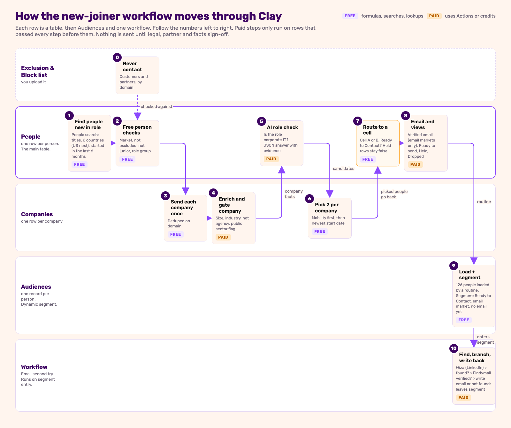

# Clay Build Guide: New in role, infrastructure and mobility, 180 days (Hypergate)

A step-by-step guide to building [`workflow-spec.md`](../workflow-spec.md) in Clay. It's written for someone who has never built anything in Clay. Follow the parts in order. Each step tells you **why** it exists, **what to click**, **what to type**, **how to check it worked** and **what it costs**.

> **Don't skip the checks.** The most common Clay mistake is running a paid column on every row before checking it on one. Every step below ends with a check. If a check fails, fix it before moving on.

> **This build already exists** in Clay (workspace 1206365, workbook `Hypergate · New joiner infra and mobility (180 days)`, links and results in [README.md](README.md)). It was brought in line with the spec on 2026-11-20. The column names below are the real ones in that workbook, so you can use this guide to rebuild it, audit it, or extend it.

> **Nothing sends yet.** The spec's status line says no sends until legal signs off the compliance brief, Hypergate sales answers the partner-region memo, Hypergate approves `facts.md`, and the 9 customer domains in the Exclusions table are filled. Copy is still pending (`/campaign-copy` hasn't run), so this guide has no copy-line formulas yet.

---

## Contents

- [What you are building](#what-you-are-building)
- [Clay words you need](#clay-words-you-need)
- [Before you start](#before-you-start)
- [Part 0. Set up the workbook](#part-0-set-up-the-workbook)
- [Part 1. Exclusion & Block list](#part-1-exclusion--block-list)
- [Part 2. Find people new in role](#part-2-find-people-new-in-role)
- [Part 3. Free checks on each person](#part-3-free-checks-on-each-person)
- [Part 4. Companies table](#part-4-companies-table)
- [Part 5. Bring company facts back to each person](#part-5-bring-company-facts-back-to-each-person)
- [Part 6. AI role check](#part-6-ai-role-check)
- [Part 7. Pick at most 2 people per company](#part-7-pick-at-most-2-people-per-company)
- [Part 8. Route each person to a cell](#part-8-route-each-person-to-a-cell)
- [Part 9. Find and verify the work email](#part-9-find-and-verify-the-work-email)
- [Part 10. Copy lines (not yet)](#part-10-copy-lines-not-yet)
- [Part 11. Views and column groups](#part-11-views-and-column-groups)
- [Part 12. Sequencer and LinkedIn queue (build it, don't run it)](#part-12-sequencer-and-linkedin-queue)
- [What it costs](#what-it-costs)
- [Run history (honest record)](#run-history-honest-record)
- [Final checklist](#final-checklist)
- [When something goes wrong](#when-something-goes-wrong)
- [Things the spec needs to fix](#things-the-spec-needs-to-fix)

---

## What you are building

The spec (section 1) says: find people who **started their current job in the last 6 months** at a regulated organisation with 201 to 5,000 staff, in a role that owns infrastructure, architecture or mobility. Check the company once, confirm with an AI column that the role is corporate IT (not, say, a plant engineer), keep at most 2 people per company, and route each one to **cell A (mobility)** or **cell B (infrastructure)**. Email only people in the UK, Switzerland, France or the US; Canada is LinkedIn-only; Germany and Austria stay held.

You will build **3 tables** inside **1 workbook**:



Each row of the picture is a table. The numbers are the order you build in. Step 0 is the list you upload first.

Why this shape:
- **People first**, because the trigger happens to a person (they started a new job). The people search is free and already filters on start date.
- **Company checks happen once per company**, in their own table. Two people at one company means one company enrichment, not two.
- **Everything paid runs last**, and only on rows that passed every free check before it. The AI column only runs on people whose company already passed, and the email lookup only on people who are `Ready to Contact?` in an email market.

What a finished row in **People** looks like, reading left to right (made-up values, not a real lead):

| Name | Job Title | Company | Start Date | Country | G3 Market | R1 Role Group | Role Focus | Ready to Contact? | Cell | Work Email | Status |
|---|---|---|---|---|---|---|---|---|---|---|---|
| Alex P. | Lead Infrastructure Architect | Acme Insurance | 2026-08 | United Kingdom | email | infrastructure | infrastructure_it | true | B | alex.p@acme… | Ready to send |

---

## Clay words you need

| Word | What it means |
|---|---|
| **Workbook** | A folder of tables for one campaign. |
| **Table** | A spreadsheet. One row per person or per company. |
| **Source** | Where a table's rows come from (a Clay search, a CSV, another table). |
| **Column** | One piece of information per row. Three kinds matter: **plain** (you type or import it), **formula** (Clay calculates it, free), **enrichment / action** (Clay calls a data provider or AI, usually costs). |
| **Formula** | A small calculation, like a spreadsheet formula. Free. Clay has an AI helper: describe what you want in plain English and it writes the formula. The plain English stays as the column's description. |
| **Enrichment** | A column that looks something up (company size, an email). Costs **credits**. |
| **Use AI** | An AI column that reads data already in the row and answers in a fixed format (here, JSON). Costs credits per row. |
| **Lookup** | A column that reads matching rows from another table in the workbook. Free. "Single row" returns one match; "multiple rows" returns a list. |
| **Send table data** | A column that copies rows from this table into another table. Free. |
| **Waterfall** | A group of email-finder columns that try providers in order until one finds a verified email. |
| **Run condition** ("Only run if") | A rule on a paid column: it only runs on rows where the rule is true. |
| **Auto-run** | When on, new columns run on every row by themselves. **Keep it off.** |
| **Credits** | Clay's usage meter for paid columns. Watch the counter before and after each paid step. |
| **View** | A saved filter on a table, like "only rows ready to send". |
| **Column group** | A named, coloured block of columns, so the table reads left to right in pipeline order. |
| **Cell (routing)** | One of the spec's 2 message routes, A or B. Not a spreadsheet cell; this guide says "routing cell" where it could be confused. |

---

## Before you start

- [ ] **Clay account** with access to workspace 1206365. Note the plan and credits left. See [What it costs](#what-it-costs).
- [ ] **The spec is open:** `output/campaigns/new-joiner-infra-mobility-180-days/workflow-spec.md`. You build from section 2 (who's in and out), 3 (sources), 4 (signals and gates) and 5 (cells).
- [ ] **The exclusions CSV** (`exclusions.csv`, 37 rows, columns `Company Name, Domain, Type, Confidence, Source, Notes`). It isn't in Git; the working copy is in `~/Downloads/exclusions.csv`.
- [ ] **Test size: 25.** For a fresh build, import 25 people first. The existing build imported 77 (see [Run history](#run-history-honest-record)).
- [ ] **Know what you may not do yet:** push leads to a sequencer, send LinkedIn requests, or run the email waterfall on more rows than you need (Part 9 explains the 30-day notice clock).

---

## Part 0. Set up the workbook

**Why:** one place for everything in this campaign.

1. In Clay, click **+ New** (top left) → **Workbook**.
2. Name it `Hypergate · New joiner infra and mobility (180 days)` (the existing workbook was renamed to this on 2026-11-20; it was first called `Hypergate-Intune Users (180 days)`).
3. In the description, paste: *"Signal: people new in role (6 months) as infrastructure or enterprise architects, systems engineers or mobility managers at regulated organisations, 201 to 5,000 staff. Spec: hypergate-gtm-os/output/campaigns/new-joiner-infra-mobility-180-days/workflow-spec.md. No sends until legal, partner-region and facts.md sign-off."*

**Check:** the workbook shows in your Clay home with that name.
**Cost:** free.

---

## Part 1. Exclusion & Block list

**Why:** spec section 2 (Exclude): Hypergate's customers and 28 listed partners are never contacted. Every person is checked against this list by **domain**.

1. Inside the workbook, **+ Add table** → **Import CSV** → upload `exclusions.csv`. Name the table `Exclusion & Block list`.
2. Change the `Domain` column's type to **URL** (column header → Edit column → Data type).
3. Turn **Auto-run off** (table menu → Auto-update / Auto-run → off).

> **Why domain and not name:** names clash and vary ("Conscia", "SoftwareONE AG"). A domain belongs to one company.

> **The 9 customer rows have no domain yet.** The research doesn't list them. A blank domain matches nothing, so those customers aren't protected. Fill each from the customer's own website before any send; don't guess.

**Check:** 37 rows, 6 columns, 28 rows with a domain.
**Cost:** free.

---

## Part 2. Find people new in role

**Why:** the trigger (spec section 1). Clay's people search filters title, location, company size, industry and the start date of the current job in one go, and it's **free**.

### 2.1 Start the search

1. **+ Add table** → **Find people**.
2. Set the filters below (spec sections 2 and 3):

| Filter | Set it to | Why |
|---|---|---|
| **Job title: include** (current job, "similar to") | Infrastructure Architect · Enterprise Architect · Systems Engineer · Mobility Manager · Data Protection Officer · End User Computing · EUC Engineer · Endpoint Engineer · Endpoint Management · Mobile Device Management · MDM Administrator · Enterprise Mobility · Mobility Engineer · Intune Engineer | Spec section 1. DPOs are imported but held (no persona). The 9 mobility titles were added on 2026-11-20 so cell A has people |
| **Job title: exclude** | Intern · Student · Apprentice · Trainee · Working Student · Recruiter · Talent Acquisition · People Partner · Account Executive · Account Manager · Business Development · Presales · Marketing · Help Desk · Service Desk · Desktop Support · Support Technician · Freelance · Contractor · Interim · Retired | Spec section 2 |
| **Company size** | 201-500 · 501-1,000 · 1,001-5,000 | Spec: 201 to 5,000 staff |
| **Company industry** | Banking · Financial Services · Insurance · Government Administration · Public Policy · Public Safety · Oil and Gas · **Law Practice · Legal Services** | Spec section 2. Law was added on 2026-11-20 and isn't in the existing search yet |
| **Started current role** (may be called "Months in current role" or "Job start date") | 6 months or less | The trigger |
| **Person location: country** | United Kingdom · Switzerland · **France** · **United States** · Canada · Germany · Austria | Spec section 2. France and the US were added on 2026-11-20 and aren't in the existing search yet. Germany and Austria are imported but held |

### 2.2 Check the count before importing

Write down the total above the preview. Spec section 7: compare it with last month's. The first pull (2026-11-19) gave **77**; with the mobility titles added on 2026-11-20 the preview counted 68 (the 6-month window had moved) and the update appended 10 people the search hadn't returned before.

### 2.3 Import

1. Set the import limit to **25** (test size).
2. Click **Import**. Name the table `People` (the existing table was renamed from `Enterprise Architects, DACH, Regulated Industries` on 2026-11-20). Name the search source column `People Search (new in role, 6 months)`.
3. **Turn Auto-run OFF** before adding any column.

### 2.4 Pull the fields out of the search result

The search result sits in one source column. Make these formula columns from it (each formula reads one field; the description is what to paste into the AI helper):

| Column | Plain English | Formula |
|---|---|---|
| `Full Name` | The person's full name, from the search result | `{{Search}}.name` |
| `First Name` | The person's first name | `{{Search}}.first_name` |
| `Last Name` | The person's last name | `{{Search}}.last_name` |
| `Job Title` | The person's current job title | `{{Search}}.matched_experience.title` |
| `LinkedIn Profile` | The person's LinkedIn profile URL | `{{Search}}.social_urls.linkedin` |
| `Country` | The country the person is located in | `{{Search}}.structured_location.country` |
| `City` | The person's city | `{{Search}}.structured_location.city` |
| `State or Province` | The person's state or province | `{{Search}}.structured_location.state_or_province` |
| `Company` | The person's current company name | `{{Search}}.matched_experience.company.name` |
| `Domain` | The current company's website domain | `{{Search}}?.matched_experience?.company?.domain` |
| `Start Date` | Start month (YYYY-MM) of the current job | `{{Search}}?.matched_experience?.start_date` |

(`{{Search}}` is the source column, `People Search (new in role, 6 months)`. Type `/` to pick it.)

> **No headline.** The search result has no headline field. The spec's AI column was changed on 2026-11-20 to read the job title, company industry and company description instead.

### 2.5 Remove duplicates

Table settings → **Deduplicate** → `LinkedIn Profile`.

**Check:** 25 rows, each with a name, title, LinkedIn Profile, Domain and Start Date. Open 3 profiles: right title, started recently?
**Cost:** free.

---

## Part 3. Free checks on each person

**Why:** drop the wrong people before paying for anything. All free.

**How to add a formula column:** **+ Add column** → **Formula**. Type the formula, or paste the plain English into **Use AI** inside the formula box. Type `/` to insert a column. Keep the plain English as the column description (checklist: every formula has one).

| Column | Plain English | Formula |
|---|---|---|
| `Assistant or Intern` | True if Job Title contains the whole word assistant or intern (not words like International or Internal) | `/\b(assistant\|intern)\b/i.test({{Job Title}} \|\| "")` |
| `T1 New in Role?` | True if Start Date is not empty and its year-month is the same as or later than the year-month 180 days ago | `!!{{Start Date}} && String({{Start Date}}).slice(0, 7) >= new Date(Date.now() - 180 * 86400000).toISOString().slice(0, 7)` |
| `G3 Market` | Market from the person's Country: United Kingdom, Switzerland, France, United States = email; Canada = linkedin_only; Germany, Austria = held; anything else = out | `({"united kingdom":"email","switzerland":"email","france":"email","united states":"email","canada":"linkedin_only","germany":"held","austria":"held"})[({{Country}} \|\| "").trim().toLowerCase()] \|\| "out"` |
| `G5 Not Junior?` | True if Assistant or Intern is not true | `{{Assistant or Intern}} !== true` |

> In tables, `\|` is a plain `|` (escaped only so the table displays). Type a plain `|` in Clay.

> The first version matched "intern" inside "International" and "Internal". Fixed on 2026-11-20 with a whole-word match; it changed 1 row.

### 3.1 `R1 Role Group` (the router, spec section 4)

- **Plain English:** *"Role group from Job Title, first match wins: mobility, mobile device, MDM, EMM, EUC, end user computing (with or without hyphen), endpoint or Intune = mobility; architect, system engineer or systems engineer, or infrastructure = infrastructure; data protection, DPO or privacy = dpo; otherwise other."*
- **Formula:**
```javascript
/\b(mobility|mobile device|mdm|emm|euc|end[- ]user computing|endpoint|intune)\b/i.test({{Job Title}} || "") ? "mobility"
: /\b(architect|systems? engineer|infrastructure)\b/i.test({{Job Title}} || "") ? "infrastructure"
: /\b(data protection|dpo|privacy)\b/i.test({{Job Title}} || "") ? "dpo"
: "other"
```
- **Check:** "Mobility Manager" → mobility. "Lead Infrastructure Architect" → infrastructure. "Data Protection Officer" → dpo.

### 3.2 Check against the Exclusion & Block list

1. **+ Add column** → **Lookup single row in other table** → table `Exclusion & Block list`, match column `Domain`, value `{{Domain}}`. Name it `Exclusion Lookup`.
2. **Run condition:** `!!{{Domain}}`
3. Run it on all rows (lookups are free).
4. Formula `G4 Not Excluded?`. Plain English: *"True if Domain is not empty and the lookup found no row in the Exclusion & Block list."*
```javascript
!!{{Domain}} && !{{Exclusion Lookup}}?.record
```

> The spec's G4 also includes "not contacted by any Hypergate workflow in the last 90 days". There's no last-contacted data yet; see [Things the spec needs to fix](#things-the-spec-needs-to-fix) 4.

**Check:** add a test row to the Exclusion & Block list with the domain of one company in People, re-run the lookup on that person: `G4 Not Excluded?` turns false. Then delete the test row.
**Cost:** free.

---

## Part 4. Companies table

**Why:** company facts (size, industry) are checked **once per company**.

### 4.1 Create it and send companies over

1. **+ Add table** → **Blank table**. Name it `Companies`. Auto-run **off**. Deduplicate on `Company Domain` once that column exists (step 4).
2. In People: **+ Add column** → **Send table data** → destination `Companies`. Name it `Send to Companies`. Send the person's columns (Clay's "Rows from" source column carries them).
3. **Run condition:** `{{G4 Not Excluded?}} === true && {{G5 Not Junior?}} === true`. Spec section 3: excluded and junior people never reach Companies, so their companies are never enriched. (Added to the existing build on 2026-11-20.)
4. In Companies, add two formulas from the incoming row:

| Column | Plain English | Formula |
|---|---|---|
| `Company Domain` | The company domain sent over from the people table | `{{Rows from}}?.Domain` |
| `Company Name` | The company name sent over from the people table | `{{Rows from}}?.Company` |

5. Table settings → **Deduplicate** → `Company Domain`.
6. Run Send table data on **1 row**, check the company arrived, then the rest.

**Check:** Companies has no duplicate domains. Count over the **All rows** view, not a filtered view (the old filtered "ICP Pass" view was deleted on 2026-11-24). The first build had no dedupe: 77 company rows with 7 domains repeated, fixed on 2026-11-20 by turning dedupe on (79 companies after the second pull).
**Cost:** free.

### 4.2 Enrich each company

1. **+ Add column** → **Enrich company**. Input: `{{Company Domain}}`.
2. **Run condition:** `!!{{Company Domain}}`
3. Run on **1 row**. Open the cell and read it. Compare with the company's LinkedIn page.
4. Then run on the rest.
5. Formulas from the result:

| Column | Plain English | Formula |
|---|---|---|
| `Country` | Headquarters country from Enrich company | `{{Enrich company}}?.country` |
| `Size` | Employee size bucket from Enrich company | `{{Enrich company}}?.size` |
| `Description` | Company description from Enrich company | `{{Enrich company}}?.description` |
| `Industry` | The company industry from Enrich company, or blank | `{{Enrich company}}?.industry \|\| ""` |

**Cost:** **1 credit per company** (measured: 75 on the first run, including about 7 duplicates enriched before dedupe; 9 on the second pull).

### 4.3 Company gates (free)

| Column | Plain English | Formula |
|---|---|---|
| `G1 Size OK?` | True if the first number in Size (the bucket's lower bound) is between 200 and 5,000 | `(Number((({{Size}} \|\| "").match(/(\d[\d,]*)/) \|\| [])[1]?.replace(/,/g, "") \|\| 0) >= 200) && (Number((({{Size}} \|\| "").match(/(\d[\d,]*)/) \|\| [])[1]?.replace(/,/g, "") \|\| 0) <= 5000)` |
| `G2 Industry OK?` | True if Industry contains Banking, Financial Services, Insurance, Government Administration, Public Policy, Public Safety, Oil and Gas, Law Practice or Legal Services | `/banking\|financial services\|insurance\|government administration\|public policy\|public safety\|oil and gas\|law practice\|legal services/i.test({{Industry}} \|\| "")` |
| `G6 Not Agency?` | True if Industry is not Staffing and Recruiting | `!/staffing and recruiting/i.test({{Industry}} \|\| "")` |
| `G7 Public Sector?` | True if Industry is Government Administration, Public Policy or Public Safety (held from email until legal answers) | `/government administration\|public policy\|public safety/i.test({{Industry}} \|\| "")` |
| `Company Gates Pass?` | True if G1 Size OK, G2 Industry OK and G6 Not Agency are all true | `{{G1 Size OK?}} === true && {{G2 Industry OK?}} === true && {{G6 Not Agency?}} === true` |

#### `C1 Segment` (context only, never routes)

- **Plain English:** *"Segment from Industry: banking (Banking, Financial Services), insurance, public_sector (Government Administration, Public Policy, Public Safety), energy (Oil and Gas), law (Law Practice, Legal Services), otherwise blank."*
```javascript
/banking|financial services/i.test({{Industry}} || "") ? "banking"
: /insurance/i.test({{Industry}} || "") ? "insurance"
: /government administration|public policy|public safety/i.test({{Industry}} || "") ? "public_sector"
: /oil and gas/i.test({{Industry}} || "") ? "energy"
: /law practice|legal services/i.test({{Industry}} || "") ? "law"
: ""
```

**Check:** read 3 rows by eye. After the second pull, 72 of 79 companies pass (one fails on size: 10,001+ staff), and some are public sector.
**Cost:** free.

> The old ICP Pass columns left over from the first build, and the Companies "ICP Pass" view that filtered on one, were deleted on 2026-11-24.

---

## Part 5. Bring company facts back to each person

In People:

1. **+ Add column** → **Lookup single row in other table** → table `Companies`, match column `Company Domain`, value `{{Domain}}`. Name it `Company Lookup`.
2. Run it on all rows (free). When you add columns to Companies later, re-run this lookup with **force re-run**, or it keeps the old snapshot.
3. Formulas:

| Column | Plain English | Formula |
|---|---|---|
| `Company Gates Pass` | True if the company row has Company Gates Pass true (size, industry, not an agency) | `{{Company Lookup}}?.record?.["Company Gates Pass"] === true` |
| `Public Sector` | True if the company row is public sector (held from email) | `{{Company Lookup}}?.record?.["G7 Public Sector"] === true` |
| `Segment` | The C1 segment from the company row | `{{Company Lookup}}?.record?.["C1 Segment"] \|\| ""` |
| `Company Industry` | The industry from the company row | `{{Company Lookup}}?.record?.["Industry"] \|\| ""` |
| `Company Description` | The company description from the company row | `{{Company Lookup}}?.record?.["Description"] \|\| ""` |

### 5.1 `A1 Eligible?` (the AI column's run condition)

- **Plain English:** *"True if T1 New in Role, Company Gates Pass, G4 Not Excluded and G5 Not Junior are true, G3 Market is email or linkedin_only, and R1 Role Group is not dpo."*
```javascript
{{T1 New in Role?}} === true && {{Company Gates Pass}} === true && {{G4 Not Excluded?}} === true && {{G5 Not Junior?}} === true && ["email","linkedin_only"].includes({{G3 Market}}) && {{R1 Role Group}} !== "dpo"
```

**Check:** a person at a company you checked in Part 4 shows the same values. After the second pull, 47 of 87 people are `A1 Eligible?`.
**Cost:** free.

---

## Part 6. AI role check

**Why:** spec signal A1. Titles like "Systems Engineer" or "Enterprise Architect" can mean corporate IT or industrial engineering. The column decides which, and returns its evidence. It's a **gate**, not a router.

1. **+ Add column** → **Use AI** (not Claygent: everything it needs is already in the row). Name it `A1 Role Focus (AI)`.
2. **Model:** GPT-4.1 Mini, on Clay's managed OpenAI account. (Grok 4.1 was tried first and Clay answered "Model does not support Use AI"; those cells were refunded.)
3. **Prompt** (paste in full, then replace the four `{{…}}` with the real columns using `/`):
   > *You classify what a person's job most likely covers. The reader is a vendor of Kerberos single sign-on for company-managed Android and iOS phones.*
   >
   > *Return role_focus as exactly one of:*
   > *- mobile_endpoint: the role owns mobile phones, tablets, EMM or MDM, Intune, or endpoint and end-user devices.*
   > *- identity_access: the role owns Active Directory, identity, authentication, access management or SSO.*
   > *- infrastructure_it: the role works on corporate IT infrastructure (servers, Windows, network, data centre, cloud platforms, enterprise IT architecture) and nothing above is stated.*
   > *- not_relevant: the role is not corporate IT: industrial, process, control or OT systems engineering (for example plant or rig systems), software or product engineering, data protection, compliance, or anything else.*
   > *- unclear: the information is too vague to tell.*
   >
   > *Rules: use only the information below and do not guess beyond it. An Enterprise Architect or Infrastructure Architect is infrastructure_it in any industry, including oil and gas, unless the title names identity or mobile. A Systems Engineer at an oil and gas company is not_relevant unless the title or description points to corporate IT. MDM next to data words (RDM, master data, reference data, data governance) means master data management, not mobile devices: not_relevant.*
   > *evidence: quote the exact words from the job title or company description that decided your answer, at most 20 words. Use an empty string if role_focus is unclear.*
   >
   > *Job title: {{Job Title}}*
   > *Company: {{Company}}*
   > *Company industry: {{Company Industry}}*
   > *Company description: {{Company Description}}*
4. **Output format: JSON**, with exactly these fields:
   - `role_focus`: text, must be one of `mobile_endpoint`, `identity_access`, `infrastructure_it`, `not_relevant`, `unclear`
   - `evidence`: text
   (If Clay rejects a "text" output type with this schema, choose JSON; that's what the existing column uses.)
5. **Run condition:** `{{A1 Eligible?}} === true`
6. Run on **3 rows you can judge yourself**: an enterprise architect, an infrastructure architect, and a systems engineer (ideally one at an oil and gas company). Read each answer and its evidence. If one is wrong, fix the prompt and re-run the same rows.
7. Then run on the rest.
8. Extractors (free):

| Column | Plain English | Formula |
|---|---|---|
| `Role Focus` | The role_focus value from A1 Role Focus (AI) | `{{A1 Role Focus (AI)}}?.role_focus \|\| ""` |
| `Role Evidence` | The evidence quote from A1 Role Focus (AI) | `{{A1 Role Focus (AI)}}?.evidence \|\| ""` |

> **What `unclear` means:** held, never sent, until a person reviews the row. `not_relevant` means dropped.

**Check:** filter `Role Focus` = not_relevant and read every `Role Evidence`. Would you agree? On the first run, a water and wastewater systems engineer in government was correctly dropped, and two enterprise architects at oil and gas companies were wrongly dropped until the "any industry" rule was added.
**Cost:** **0.2 credits per row** (measured 2026-11-20). Spent so far: 10.0 credits for 47 rows, including 3 re-runs after prompt fixes. The master-data rule was added after "MDM & RDM Analyst" first came back mobile_endpoint; it re-ran as not_relevant.

---

## Part 7. Pick at most 2 people per company

**Why:** spec G8: at most 2 contacts per company, mobility first, then the newest start date. Picking happens per company, so Companies picks and each person reads back whether they were picked. All free.

### 7.1 In People: who is a candidate

| Column | Plain English | Formula |
|---|---|---|
| `Role Rank` | 1 if R1 Role Group is mobility, 2 if infrastructure, otherwise 9 (used to pick champions first) | `({"mobility":1,"infrastructure":2})[{{R1 Role Group}}] \|\| 9` |

#### `Candidate OK?`
- **Plain English:** *"True if T1 New in Role, Company Gates Pass, G4 Not Excluded and G5 Not Junior are true, G3 Market is email or linkedin_only, R1 Role Group is mobility or infrastructure, and Role Focus is mobile_endpoint, identity_access or infrastructure_it."*
```javascript
{{T1 New in Role?}} === true && {{Company Gates Pass}} === true && {{G4 Not Excluded?}} === true && {{G5 Not Junior?}} === true && ["email","linkedin_only"].includes({{G3 Market}}) && ["mobility","infrastructure"].includes({{R1 Role Group}}) && ["mobile_endpoint","identity_access","infrastructure_it"].includes({{Role Focus}})
```

### 7.2 In Companies: pick 2

1. **+ Add column** → **Lookup multiple rows in other table** → table `People`, match column `Domain`, value `{{Company Domain}}`, limit 100. Name it `People Found`. Run on all rows (free, force re-run when People changes).
2. Formula `Chosen Contacts`:
   - **Plain English:** *"From People Found, keep people with Candidate OK true, sort by Role Rank (mobility first) then newest Start Date, take the first 2 and return their LinkedIn Profiles separated by a space."*
```javascript
(({{People Found}})?.records || []).filter(p => p["Candidate OK"] === true).sort((a, b) => (Number(a["Role Rank"]) - Number(b["Role Rank"])) || String(b["Start Date"] || "").localeCompare(String(a["Start Date"] || ""))).slice(0, 2).map(p => p["LinkedIn Profile"]).join(" ")
```
3. Formula `Company Status`: *"Failed gates if Company Gates Pass is not true; Hold: no contact if Chosen Contacts is empty; otherwise Has contacts."*
```javascript
!({{Company Gates Pass?}} === true) ? "Failed gates" : !({{Chosen Contacts}}) ? "Hold: no contact" : "Has contacts"
```

### 7.3 Back in People: was I picked?

1. Force re-run `Company Lookup` so it carries `Chosen Contacts`.
2. Formulas:

| Column | Plain English | Formula |
|---|---|---|
| `Chosen Contacts` | Chosen Contacts from the company row | `{{Company Lookup}}?.record?.["Chosen Contacts"] \|\| ""` |
| `G8 Picked?` | True if LinkedIn Profile is one of the 2 people listed in Chosen Contacts | `!!{{LinkedIn Profile}} && ({{Chosen Contacts}} \|\| "").split(" ").includes({{LinkedIn Profile}})` |

**Check:** no company has more than 2 people with `G8 Picked?` true. On the first pull, one company had 3 candidates and the third was dropped.
**Cost:** free.

---

## Part 8. Route each person to a cell

All in People, all free.

### 8.1 `Ready to Contact?`

- **Plain English:** *"True if Candidate OK and G8 Picked are both true: new in role, company fits, not excluded, not junior, contactable market, mobility or infrastructure role confirmed by the AI, and one of max 2 per company."*
```javascript
{{Candidate OK?}} === true && {{G8 Picked?}} === true
```

### 8.2 `Cell` (spec section 5)

- **Plain English:** *"Routing cell: if Ready to Contact is true, A when R1 Role Group is mobility, B when it is infrastructure; otherwise blank."*
```javascript
!{{Ready to Contact?}} ? "" : {{R1 Role Group}} === "mobility" ? "A" : {{R1 Role Group}} === "infrastructure" ? "B" : ""
```

> **Held rows stay false** (spec section 4): Germany and Austria (`G3 Market` = held), DPOs (`R1 Role Group` = dpo) and AI `unclear` can never be `Ready to Contact?`, because `Candidate OK?` requires an email or linkedin_only market, a mobility or infrastructure role group, and a passing `Role Focus`.

**Check:** filter `Ready to Contact?` = true. No row has `G3 Market` = held, `R1 Role Group` = dpo, or `Role Focus` = unclear. After the second pull: 41 rows, cell A 6 and cell B 35.
**Cost:** free.

---

## Part 9. Find and verify the work email

**Why:** only email the people we'll actually email. This is the most expensive step. Two rules from the compliance brief:
- **Email markets only.** The waterfall runs only on `Ready to Contact?` people in the UK, Switzerland, France or the US. Canada is LinkedIn-only; Germany and Austria are held.
- **30-day notice clock** (gate G7-C3). Once you collect an email, you have a month to tell the person where you got it. Don't run the waterfall far ahead of a send.

### 9.1 The waterfall

1. **+ Add column** → **Find Email 2 (Kitt)** (Clay's waterfall). Inputs: full name, `{{Domain}}`, `{{LinkedIn Profile}}`.
2. Providers, in this order (as built): `Find Email 1 (Icypeas)` → `Find Email 2 (Kitt)` → `Find Email 3 (Enrow)` → `Find Email 4 (LeadMagic)` → `Find Email 5 (Findymail)`, each followed by `Verify N (Findymail)`. Validation strategy: **conservative**, no catch-all.
3. **Run condition** on the first find step (Clay copies it into the later steps): `{{Ready to Contact?}} === true && {{G3 Market}} === "email" && {{Public Sector}} !== true`. Public-sector emails are held until legal answers, so they aren't looked up (added 2026-11-20).
4. Run on **1 row**, read the result, then the rest of the eligible rows.
5. The waterfall writes the verified email into `Work Email`.

### 9.2 Provenance and safety columns

#### `Email Source` (which provider found it)
- **Plain English:** *"Which provider found Work Email: Icypeas (Find Email 1 (Icypeas)), Kitt (Find Email 2 (Kitt)), Enrow (Find Email 3 (Enrow), stored under result), LeadMagic (Find Email 4 (LeadMagic)) or Findymail (Find Email 5 (Findymail)); blank if no email."*
```javascript
!{{Work Email}} ? "" : ({{Find Email 1 (Icypeas)}}?.email === {{Work Email}}) ? "Icypeas" : ({{Find Email 2 (Kitt)}}?.email === {{Work Email}}) ? "Kitt" : ({{Find Email 3 (Enrow)}}?.result?.email === {{Work Email}}) ? "Enrow" : ({{Find Email 4 (LeadMagic)}}?.email === {{Work Email}}) ? "LeadMagic" : ({{Find Email 5 (Findymail)}}?.email === {{Work Email}}) ? "Findymail" : "unknown"
```
> Enrow keeps the email under `result.email`, not `email`. That's why the first version of this formula returned "unknown" for 8 rows.

#### `Email Found On` (date)
A plain **date** column. A formula can't read when a cell ran, so fill it on each waterfall run with the run date. In the existing build it was backfilled on 2026-11-20 from each provider cell's finish time (57 rows, all 2026-11-19).

| Column | Plain English | Formula |
|---|---|---|
| `Email Domain OK?` | True if the part of Work Email after @ equals Domain | `!!{{Work Email}} && ((({{Work Email}} \|\| "").split("@")[1] \|\| "").toLowerCase() === ({{Domain}} \|\| "").toLowerCase().replace(/^www\./, ""))` |
| `E1 Email Sendable?` | True if Work Email is filled (validated by the waterfall), Email Domain OK is true, and Email Source and Email Found On are filled | `!!{{Work Email}} && {{Email Domain OK?}} === true && !!{{Email Source}} && {{Email Source}} !== "unknown" && !!{{Email Found On}}` |
| `Ready for Email?` | True if Ready to Contact is true, G3 Market is email, Public Sector is not true and E1 Email Sendable is true | `{{Ready to Contact?}} === true && {{G3 Market}} === "email" && {{Public Sector}} !== true && {{E1 Email Sendable?}} === true` |

**Check:** every `Ready for Email?` row has a source, a date and a matching domain. After the second pull: 18 rows.
**Cost:** about **2.7 net credits per email found** (measured 2026-11-19: 152 net credits for 57 emails; lookups that find nothing are refunded).

---

## Part 10. Copy lines (not yet)

The spec's status is **copy pending**. `/campaign-copy` writes the copy for cells A and B, after the NTLM claim (cell B) is added to `facts.md` as pending Hypergate approval. When it's done, each approved line becomes a formula column that starts with `!{{Ready to Contact?}} ? "" :`, with wording copied verbatim from the spec. Spintax stays in the sequencer.

Variables already available for copy (spec section 6): `First Name`, `Company`, `Job Title`, `Start Date` (for `{{start_month}}`), `Segment`. Add a cleaned company name (strip Inc, Ltd, AG, GmbH and the rest of the spec's list) when copy needs it.

---

## Part 11. Views and column groups

**Why:** checklist item: Ready to send, Held and Dropped views, columns grouped. One `Status` column makes every view a single filter.

### 11.1 `Status` (People)

- **Plain English:** *"Ready to send if Ready for Email is true. Review: email domain if Ready to Contact is true, G3 Market is email, Public Sector is not true, Work Email is filled but Email Domain OK is not true. LinkedIn only if otherwise Ready to Contact. Held if G3 Market is held, R1 Role Group is dpo or Role Focus is unclear. Otherwise Dropped."*
```javascript
{{Ready for Email?}} === true ? "Ready to send"
: ({{Ready to Contact?}} === true && {{G3 Market}} === "email" && {{Public Sector}} !== true && !!{{Work Email}} && {{Email Domain OK?}} !== true) ? "Review: email domain"
: {{Ready to Contact?}} === true ? "LinkedIn only"
: ({{G3 Market}} === "held" || {{R1 Role Group}} === "dpo" || {{Role Focus}} === "unclear") ? "Held"
: "Dropped"
```

### 11.2 Views (view dropdown → **+ New view** → one filter each)

| Table | View | Filter | Who uses it |
|---|---|---|---|
| People | `Ready to send` | `Status` = Ready to send | Whoever loads the sequencer |
| People | `LinkedIn queue` | `Status` = LinkedIn only | Manual LinkedIn steps (Canada, public sector, no sendable email) |
| People | `Review: email domain` | `Status` = Review: email domain | Check by hand; don't send |
| People | `Held` | `Status` = Held | Germany, Austria, DPOs, AI unclear |
| People | `Dropped` | `Status` = Dropped | Spot-checking the gates |
| Companies | `Hold: no contact` | `Company Status` = Hold: no contact | Companies with nobody to contact |
| Companies | `Failed gates` | `Company Status` = Failed gates | Spot-checking G1, G2, G6 |

### 11.3 Column groups (left to right)

People: **Person (from search)** · **Company facts** · **Gates (free)** · **AI role check** · **Routing** · **Email checks**, with the email waterfall in its own group. Companies: **Company** · **Enrichment** · **Gates (free)** · **Contacts**. Exclusion & Block list: **Never contact**. Select columns → right-click → **Group columns** (may be called "Create group"). Don't hide paid columns or lookups: they show where data came from.

**Check:** after the second pull: Ready to send 18, LinkedIn only 22, Review: email domain 1, Held 38, Dropped 8.
**Cost:** free.

---

## Part 12. Sequencer and LinkedIn queue

**Build nothing that sends.** Blockers: legal sign-off, the partner-region decision, `facts.md` approval, the 9 customer domains, copy (pending), the sending entity for `{{sender_signature}}`, and the sequencer choice (EmailBison recommended if it confirms EU-only hosting and its DPA, otherwise Instantly: [tools/sequencer-comparison.md](../../../../tools/sequencer-comparison.md)).

When those are cleared:
1. Create the campaign in the sequencer, **paused**, with the copy from `/campaign-copy` and the compliance footer (entity, postal address, unsubscribe, privacy-notice link; compliance brief section 12.3).
2. In People: the sequencer's "Add lead to campaign" action, run condition `{{Ready for Email?}} === true`. On launch day, 1 row first.
3. Add a plain date column `Last Contacted At`, filled when the push runs. It feeds the 90-day rule in G4.
4. **LinkedIn is manual** (LinkedIn's User Agreement bans automation tools): work from the `LinkedIn queue` and `Ready to send` views. Day 2 connection request with no note; day 7 one DM, only if connected.

**Cost:** about 1 credit per lead pushed (not yet run).

---

## What it costs

Free: the search and import, every formula, lookups, Send table data, views and groups.

Paid, and only on rows that passed every check before it:

| Step | Runs on | Measured cost |
|---|---|---|
| Enrich company (4.2) | Each company sent from People | 1 credit per company |
| A1 Role Focus (AI) (6) | `A1 Eligible?` rows | 0.2 credits per row |
| Email waterfall (9.1) | `Ready to Contact?` rows in email markets | about 2.7 net credits per email found |
| Sequencer push (12) | `Ready for Email?` rows, on launch day | about 1 credit per lead (not run) |

**Example for a 25-person test** (illustrative, scaled from the 77-row run; real numbers depend on the search):
- Say 25 people at 23 companies → Enrich company **about 23 credits**.
- About half pass to the AI column (39 of 77 did) → 13 rows × 0.2 = **about 3 credits**.
- About 1 in 3 is `Ready to Contact?` in an email market (26 of 77 did) → 8 rows, and about 6 emails found → **about 16 credits**.
- **Total: about 40 to 45 credits.**

Watch the credits counter before and after each paid step and write the numbers down.

---

## Run history (honest record)

- **2026-11-19:** the first build ran the people search (77 people), Send table data, Enrich company (75 of 77 company rows, 75 credits, no dedupe yet) and the email waterfall (72 rows, 152 net credits, 57 emails) **with auto-run on and before run conditions existed** on Enrich company and the waterfall. There was no recorded 1-row proof for those steps. The waterfall ran on Germany and Canada too (8 and 10 emails); those rows are now held or LinkedIn-only and never reach `Ready for Email?`.
- **2026-11-20:** auto-run turned off on all 3 tables; run conditions added to Enrich company and the waterfall; every formula, gate, view and group above added; the AI column proven on 3 rows, then run on the rest (8.4 credits including 2 re-runs after a prompt fix and 1 row unlocked by the intern fix). From now on, every paid step follows the 1-row rule (3 rows for AI).
- **2026-11-20, correction:** the Companies table had no dedupe and 77 rows (7 domains repeated); counts read earlier from its filtered first view said 70. Dedupe on `Company Domain` switched on (8 duplicate rows removed).
- **2026-11-20, second pull:** 9 mobility titles added; 10 new people appended. Free steps, then Enrich company (1-row proof, then 8 more: 9 credits), AI (3-row proof, then 4: 1.4 credits) and the email waterfall (1-row proof, then 2: 3 credits). Public-sector rows and one likely AI false positive were left out of the email lookup.
- **2026-11-24, third pull (non-US widened search):** 39 new people (UK 12, CH 11, DE 7, FR 6, CA 3), 32 new companies. Enrich company 1-row proof then 31 (32 credits); AI 3-row proof then 23 (26 rows, about 5.2 credits; 12 bare "System Engineer" titles came back unclear and are held); email waterfall 1-row proof then 11 (10 found; 8 Ready to send, 2 Review: email domain). About 68 credits in total, measured from the workspace balance.
- **2026-11-20, re-proof:** Enrich company force re-run on 1 company (SUCCESS, same size, industry and country, 1 credit). Email waterfall force re-run on 1 contact: Icypeas found the same email and Findymail validated it (0.5 + 1 credits); that row's `Email Found On` was reset to the re-run date. Both paid steps are now proven on 1 row with their current run conditions.

---

## Final checklist

- [ ] Auto-run is **off** on all 3 tables.
- [ ] Every paid column has a **run condition** (Enrich company, A1, every waterfall step).
- [x] `Send table data` has its run condition (Part 4.1, step 3; added 2026-11-20).
- [ ] Every new paid column was tested on 1 row (AI: 3 rows) before the rest.
- [ ] Every lookup matches on **domain**.
- [ ] Companies has no duplicate domains; People has no duplicate LinkedIn profiles.
- [ ] No company has more than 2 people with `G8 Picked?` true.
- [ ] No held row (Germany, Austria, DPO, AI unclear) is `Ready to Contact?`.
- [ ] No Canadian, German or Austrian row is `Ready for Email?`.
- [ ] Every formula has a plain-English description; columns are grouped; the views exist.
- [ ] Sequencer not connected, no LinkedIn requests sent.
- [ ] Credits spent are written down per step.

---

## When something goes wrong

| What you see | Likely cause | Fix |
|---|---|---|
| Search shows 0 people | A filter is too strict (often start date or titles) | Remove filters one at a time |
| A paid column ran on every row | Auto-run was on, or no run condition | Turn auto-run off, add the run condition. Spent credits don't come back; note them |
| AI cells show "Model does not support Use AI" | The model ID isn't available for Use AI | Switch the model (GPT-4.1 Mini works); failed cells are refunded |
| `Role Focus` is blank on eligible rows | The AI column wasn't run, or the extractor points at the wrong field | Run A1 on 1 row; check `?.role_focus` |
| `Email Source` says "unknown" | A provider stores the email in a different field (Enrow uses `result.email`) | Open the provider cell, find the email field, update the formula |
| New Companies columns don't show in People | The lookup keeps its old snapshot | Force re-run `Company Lookup` |
| "International ..." or "Internal ..." titles are flagged junior | An old `Assistant or Intern` formula matches "intern" inside words | Use the whole-word formula in Part 3 |
| Lookup finds nothing | Domains written differently (`www.`, `https://`) | Compare side by side; type domains plain |
| Formula shows an error | A column name changed, or a value is blank | Re-pick the column with `/`; guard blanks with `\|\| ""` |

---

## Things the spec needs to fix

Found while writing this guide. Update [`workflow-spec.md`](../workflow-spec.md); this guide didn't edit it.

1. **Section 2, title excludes / G5:** fixed in the build on 2026-11-20 (whole-word match, Part 3). No spec change needed.
2. **Sections 1 and 3, mobility titles:** done on 2026-11-20 (9 titles added to the search, `intune` added to R1). Cell A went from 0 to 7 contacts. Spec updated.
3. **Section 3, Send table data:** the existing build sent everyone to Companies. Fixed in Clay on 2026-11-20 (run condition in Part 4.1); no spec change needed.
4. **Section 4, G4 90-day rule:** nothing records "last contacted" yet. Add `Last Contacted At` when the sequencer is connected (Part 12), and replace it with the Zoho CRM check later.
5. **Section 4, E1 provenance (done 2026-11-24):** the spec now says `Email Found On` is set to the run date on every row that got an email after each waterfall run. Done with `tools/rex` for the third pull.
6. **Leftover columns (done 2026-11-24):** the old ICP Pass columns and view, and the 6 disabled waterfall steps (Hunter, Prospeo, Datagma, Wiza, SMARTe, Dropcontact) with their 6 verify columns, were deleted. The Work Email waterfall now has 5 steps, and its group run condition is Ready to Contact true, market email, not public sector.
7. **Column names:** done on 2026-11-20. Each waterfall step is now named by position and provider (`Find Email 1 (Icypeas)`, `Verify 1 (Findymail)` and so on), the lookups are `Exclusion Lookup` and `Company Lookup`, and Send table data is `Send to Companies`.
8. **Section 2, search changes (partly done 2026-11-24):** law industries and France added to the live search; 39 new people appended. The United States (234 matches in the free preview) is still to pull, as a capped batch.
11. **Renamed columns broke 3 lookup formulas (fixed 2026-11-24):** the 2026-11-20 readability pass dropped the `?` from Companies and People column names, but People `Company Gates Pass` and `Public Sector` still read `"Company Gates Pass?"` / `"G7 Public Sector?"` from the lookup, and Companies `Chosen Contacts` read `"Candidate OK?"`. Old rows kept their pre-rename values; any refresh would have blanked them, and a blank Public Sector counts as not public sector. All three now read the current names; a full refresh left every old row's values unchanged. Note: formulas and plain-English lines elsewhere in this guide still show the older `?` names.
12. **R1 missed singular titles (fixed 2026-11-24):** `systems engineer` didn't match "System Engineer" (common in CH and DE) and `end user computing` didn't match "End-User Computing". Now `systems? engineer` and `end[- ]user computing`. Old rows' role groups unchanged.
9. **Section 4, A1 prompt:** done on 2026-11-20. Rule added (MDM next to data words = master data, not_relevant); the "MDM & RDM Analyst" row re-ran as not_relevant (0.2 credits).
10. **Section 3, email waterfall run condition:** done on 2026-11-20 in the build and the spec ("and not public sector" on all 5 find steps).
